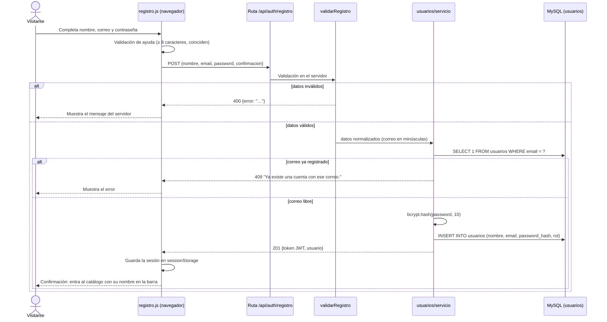
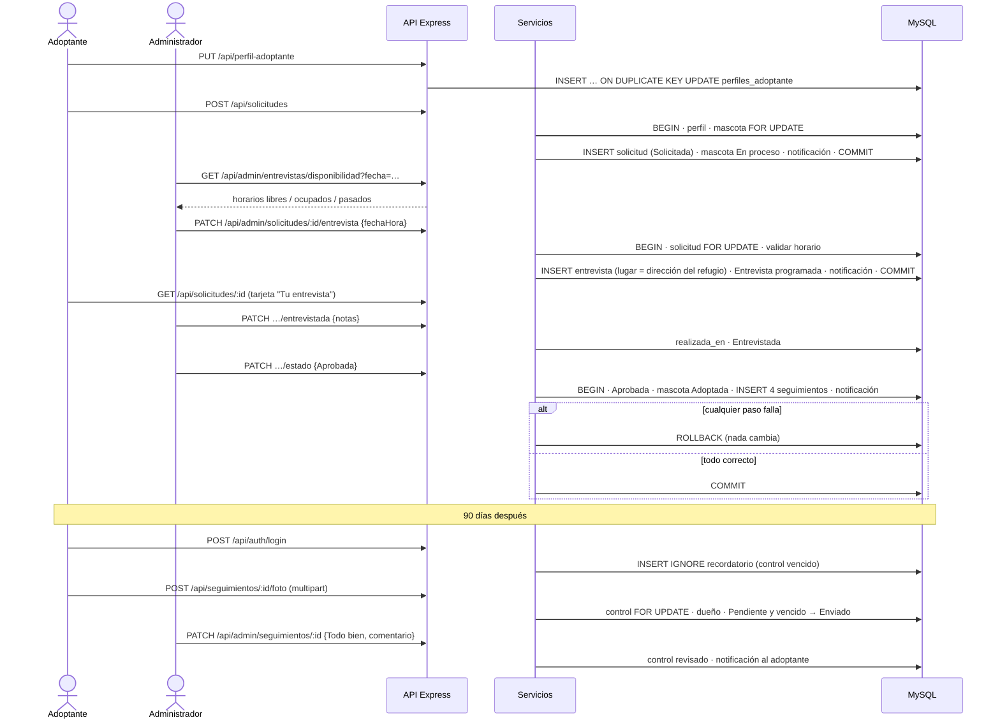

# 3. Funcionalidades implementadas

> Versión 3.0 — III Parcial (`v1.0.0`). Las secciones 3.13 a 3.18 describen el proceso de adopción completo agregado en este parcial.

Cada funcionalidad se describe con la misma estructura: requisito, interfaz, lógica de negocio, datos, resultado (con su evidencia) y manejo de errores. Las capturas están en [`docs/evidencias/`](evidencias/) y las pruebas en [`14_suite_vv_final.md`](14_suite_vv_final.md).

## 3.1 Registro de adoptantes

| Aspecto | Detalle |
|---|---|
| **Requisito implementado** | RF-01 (y RNF-02) |
| **Interfaz** | `registro.html` + [`public/js/paginas/registro.js`](../public/js/paginas/registro.js) |
| **Lógica** | `POST /api/auth/registro` → [`usuarios/servicio.js`](../src/modules/usuarios/servicio.js): valida nombre (≥ 2), formato de correo y contraseña (8 a 72 bytes); normaliza el correo a minúsculas; comprueba que no exista; guarda la contraseña con **bcrypt** (10 rondas); asigna el rol *adoptante* y devuelve un JWT para iniciar sesión directamente |
| **Datos** | Tabla `usuarios` (`email UNIQUE`, `password_hash`). `SELECT 1 FROM usuarios WHERE email = ?` → `INSERT INTO usuarios (...) VALUES (?, ?, ?, ?)` |
| **Resultado** | 201 con token y datos públicos (nunca el hash). Evidencia: PR-01, [`PR-01_registro_exitoso.png`](evidencias/PR-01_registro_exitoso.png) |
| **Manejo de errores** | 400 con todos los motivos de validación (PR-03); 409 "Ya existe una cuenta con ese correo." (PR-02, [captura](evidencias/PR-02_registro_correo_duplicado.png)), también si dos registros llegan a la vez (`ER_DUP_ENTRY`); el navegador repite las validaciones para orientar al usuario |

## 3.2 Inicio de sesión

| Aspecto | Detalle |
|---|---|
| **Requisito implementado** | RF-02 (corrige el hallazgo 3) |
| **Interfaz** | `login.html` + [`public/js/paginas/login.js`](../public/js/paginas/login.js); la sesión se guarda en `sessionStorage` (token, id, nombre, rol y vencimiento) mediante [`public/js/comun.js`](../public/js/comun.js) |
| **Lógica** | `POST /api/auth/login`: busca al usuario por correo, compara con `bcrypt.compare` (también contra un hash simulado si el correo no existe, para no revelar qué dato falló) y firma un JWT HS256 con `sub` = id y `rol`, válido por `JWT_EXPIRA` (4 h). Límite de 5 intentos fallidos cada 15 minutos. Si ya hay sesión, Login y Registro redirigen al catálogo o al panel |
| **Datos** | `SELECT ..., password_hash FROM usuarios WHERE email = ?` |
| **Resultado** | 200 con token; el administrador va al panel y el adoptante al catálogo. Evidencia: PR-04, [`PR-04_login_valido_admin.png`](evidencias/PR-04_login_valido_admin.png) |
| **Manejo de errores** | 401 genérico "Correo o contraseña incorrectos." (PR-05, [captura](evidencias/PR-05_login_error.png)); 429 tras 5 intentos fallidos (PR-06); un token vencido o alterado responde 401 y el frontend cierra la sesión y vuelve al login |

## 3.3 Catálogo de mascotas

| Aspecto | Detalle |
|---|---|
| **Requisito implementado** | RF-03, PB-16 |
| **Interfaz** | `catalogo-publico.html` (visitantes) y `catalogo.html` (con sesión), ambos con [`public/js/paginas/catalogo.js`](../public/js/paginas/catalogo.js) |
| **Lógica** | `GET /api/mascotas?estado=Disponible,En proceso&tipoId=&q=` (público). Por defecto el catálogo muestra solo *Disponibles* y *En proceso* (estas al final); el filtro *Ver adoptadas* cambia a `estado=Adoptada` con el título "Mascotas adoptadas". Los filtros de tipo se generan con `GET /api/tipos-mascota?activos=1&conMascotas=1&estado=…`, contando solo las mascotas de la vista actual, así que un tipo nuevo o desactivado se refleja sin cambiar código. La búsqueda se hace en el servidor y escapa los comodines `%` y `_` |
| **Datos** | `mascotas` ⋈ `tipos_mascota`, ordenadas por estado (Disponible primero) y nombre; índice `ix_mascotas_estado_tipo` |
| **Resultado** | Tarjetas con foto real (o una huella SVG si no tiene foto), edad, tipo y estado. Evidencia: PR-07 y PR-28, [`PR-07_catalogo_filtro_gato.png`](evidencias/PR-07_catalogo_filtro_gato.png), [`PR-28_catalogo_sin_adoptadas.png`](evidencias/PR-28_catalogo_sin_adoptadas.png), [`PR-28_ver_adoptadas.png`](evidencias/PR-28_ver_adoptadas.png) |
| **Manejo de errores** | Filtro de tipo o estado inválido → 400; sin resultados → "No se encontraron mascotas con ese criterio."; si la API no responde se muestra el mensaje de conexión |

## 3.4 Ficha de detalle

| Aspecto | Detalle |
|---|---|
| **Requisito implementado** | RF-04 |
| **Interfaz** | `detalle.html` + [`public/js/paginas/detalle.js`](../public/js/paginas/detalle.js) — ahora pública (antes exigía sesión aunque el catálogo público enlazaba a ella) |
| **Lógica** | `GET /api/mascotas/:id`. El botón depende del estado y del rol: *Solicitar adopción* (adoptante y mascota disponible), *Inicia sesión para solicitar* (visitante), *En proceso de adopción* deshabilitado (en proceso), el aviso *"Esta mascota ya encontró un hogar"* sin botón (adoptada), y sin botón para el administrador |
| **Datos** | `SELECT ... FROM mascotas m JOIN tipos_mascota t ... WHERE m.id = ?` |
| **Resultado** | Foto, tipo, raza, edad, sexo, descripción y estado. Evidencia: PR-08, [`PR-08_detalle_mascota.png`](evidencias/PR-08_detalle_mascota.png), [`pantalla_movil_detalle.png`](evidencias/pantalla_movil_detalle.png) |
| **Manejo de errores** | Id no numérico → 400; mascota inexistente → 404 "Mascota no encontrada." con enlace de regreso al catálogo |

## 3.5 Enviar solicitud de adopción

| Aspecto | Detalle |
|---|---|
| **Requisito implementado** | RF-06, RF-11 (completa PB-08 en el servidor) |
| **Interfaz** | `solicitar.html` + [`public/js/paginas/solicitar.js`](../public/js/paginas/solicitar.js) |
| **Lógica** | `POST /api/solicitudes` (solo adoptantes). Valida teléfono `8888-1234`, dirección (≥ 5) y motivo (≥ 10). **Transacción:** exige el perfil completo, bloquea la mascota con `SELECT … FOR UPDATE`, rechaza si no está *Disponible* o si ya hay una solicitud activa, inserta la solicitud *Solicitada*, cambia la mascota a *En proceso* y crea la notificación "Recibimos tu solicitud". Si el adoptante no tiene perfil, la página lo lleva a *Mi perfil* y luego lo devuelve |
| **Datos** | `perfiles_adoptante`, `mascotas`, `solicitudes` (`CHECK` del teléfono, `UNIQUE mascota_activa`), `notificaciones` |
| **Resultado** | 201; la solicitud aparece de inmediato en *Mis solicitudes* con aviso de envío. Evidencia: PR-14, [`PR-14_solicitud_enviada.png`](evidencias/PR-14_solicitud_enviada.png) |
| **Manejo de errores** | 400 sin perfil (PR-34, [E2E-11](evidencias/final/e2e/E2E-11_solicitar_sin_perfil.png)); 400 por teléfono u otros campos (PR-15, [captura](evidencias/PR-15_telefono_invalido.png)); 409 si la mascota ya no está disponible (PR-16, [captura](evidencias/PR-16_mascota_no_disponible.png)); dos solicitudes simultáneas: solo una se guarda (PR-20); cualquier fallo intermedio → `ROLLBACK` |

## 3.6 Seguimiento de la solicitud

| Aspecto | Detalle |
|---|---|
| **Requisito implementado** | RF-05, RF-12, RF-13, RNF-01 |
| **Interfaz** | `seguimiento.html` + [`public/js/paginas/seguimiento.js`](../public/js/paginas/seguimiento.js): línea de tiempo de 5 etapas con iconos SVG y la fecha de cada una (horizontal en escritorio, vertical en celular), mensaje según la etapa, tarjeta **"Tu entrevista"** (día en texto, hora y dirección), sección **"Seguimiento de tu adopción"** si está aprobada, y datos enviados |
| **Lógica** | `GET /api/solicitudes/:id`: solo su dueño o un administrador pueden verla |
| **Datos** | `solicitudes` ⋈ `mascotas` ⋈ `tipos_mascota` ⋈ `usuarios` por id; `entrevistas` por `solicitud_id` (sin `notas_admin` para el adoptante); `seguimientos` si está aprobada |
| **Resultado** | Responde en menos de 2 s (máx. 86,7 ms medido, VO-01). Evidencia: PR-21, PR-41, [`PR-21_seguimiento_solicitada.png`](evidencias/PR-21_seguimiento_solicitada.png), [`E2E-05`](evidencias/final/e2e/E2E-05_seguimiento_con_entrevista.png), [`PR-18_seguimiento_aprobada.png`](evidencias/PR-18_seguimiento_aprobada.png) |
| **Manejo de errores** | Solicitud de otra persona → 403 "No tienes permiso para ver esta solicitud."; inexistente → 404 |

## 3.7 Historial de solicitudes propias

| Aspecto | Detalle |
|---|---|
| **Requisito implementado** | RF-10 |
| **Interfaz** | `mis-solicitudes.html` + [`public/js/paginas/mis-solicitudes.js`](../public/js/paginas/mis-solicitudes.js) |
| **Lógica** | `GET /api/solicitudes/mias`: solo las del usuario del token, de la más reciente a la más antigua |
| **Datos** | `SELECT ... FROM solicitudes ... WHERE s.usuario_id = ? ORDER BY s.fecha DESC`; índice `ix_solicitudes_usuario (usuario_id, fecha)` |
| **Resultado** | Tarjetas con foto, número de solicitud, fecha y estado; cada una abre su seguimiento. Evidencia: PR-14 |
| **Manejo de errores** | Sin solicitudes → mensaje con enlace al catálogo; sin sesión → 401 y redirección al login |

## 3.8 Revisar y decidir solicitudes (administrador)

| Aspecto | Detalle |
|---|---|
| **Requisito implementado** | RF-08, RNF-04 |
| **Interfaz** | Tabla "Solicitudes en curso" de `admin.html` y página de detalle `admin-solicitud.html` ([`admin-solicitud.js`](../public/js/paginas/admin-solicitud.js)) con los datos, el perfil del adoptante, la entrevista y la tarjeta **Decisión**; **Aprobar** solo se habilita si la solicitud está *Entrevistada* |
| **Lógica** | `GET /api/admin/solicitudes?estado=Solicitada,Entrevista programada,Entrevistada`, `GET /api/admin/solicitudes/:id` y `PATCH /api/admin/solicitudes/:id/estado` (solo admin). **Transacción:** bloquea la solicitud y la mascota. *Aprobada* exige *Entrevistada*, cambia la mascota a *Adoptada* y programa los controles; *Rechazada* se permite en cualquier etapa activa, devuelve la mascota a *Disponible* y cancela la entrevista no realizada. En ambos casos se crea la notificación |
| **Datos** | `solicitudes`, `mascotas`, `notificaciones` (`UNIQUE mascota_aprobada`) |
| **Resultado** | La mascota cambia de estado y el adoptante recibe la notificación. Evidencia: PR-18, [`PR-18_solicitud_aprobada.png`](evidencias/PR-18_solicitud_aprobada.png) |
| **Manejo de errores** | Adoptante → 403 (PR-17); aprobar sin entrevista → 409 (PR-40); solicitud ya respondida → 409; fallo en cualquier paso, incluida la creación de los controles → `ROLLBACK` sin cambios (PR-19, PR-46) |

## 3.9 Gestión del catálogo, tipos y fotos (administrador)

| Aspecto | Detalle |
|---|---|
| **Requisito implementado** | RF-09, PB-10, PB-16 (cierra el hallazgo 4) |
| **Interfaz** | Secciones "Gestión de mascotas" y "Tipos de mascota" de `admin.html`: agregar y editar mascotas (incluido el estado), subir, reemplazar o quitar la foto con vista previa, y agregar, editar, activar o desactivar tipos |
| **Lógica** | `POST`/`PUT /api/mascotas` (`multipart/form-data`) y `POST`/`PUT /api/tipos-mascota`, solo admin. Reglas: el tipo debe existir y estar activo; *En proceso* solo lo asigna una solicitud; no se cambia el estado de una mascota con una solicitud activa o *Aprobada*; las fotos deben ser JPG, PNG o WEBP de hasta 2 MB y se verifica su firma binaria |
| **Datos** | `mascotas` (`foto_url`), `tipos_mascota` (`UNIQUE nombre`, `activo`); archivos en `uploads/mascotas/` |
| **Resultado** | Los cambios se ven al instante en el catálogo y el detalle. Evidencia: PR-11 ([formulario](evidencias/PR-11_formulario_con_vista_previa.png), [resultado](evidencias/PR-11_mascota_con_foto.png)), PR-13 ([captura](evidencias/PR-13_tipo_desactivado.png)), [`pantalla_panel_admin.png`](evidencias/pantalla_panel_admin.png) |
| **Manejo de errores** | Tipo duplicado → 409 (PR-09, [captura](evidencias/PR-09_tipo_duplicado.png)); foto inválida → 400 y el archivo se borra (PR-12, [captura](evidencias/PR-12_foto_invalida.png)); cambio de estado no permitido → 409; adoptante → 403 (PR-10) |

## 3.10 Notificaciones

| Aspecto | Detalle |
|---|---|
| **Requisito implementado** | RF-07, PB-09 (como notificaciones internas; el correo queda fuera de alcance) |
| **Interfaz** | Contador de no leídas en la barra y `notificaciones.html` ([`public/js/paginas/notificaciones.js`](../public/js/paginas/notificaciones.js)) con las no leídas destacadas, fechas relativas, enlace al seguimiento y botones para marcarlas |
| **Lógica** | Las notificaciones se crean **dentro** de las transacciones (solicitud recibida, entrevista agendada o reprogramada, aprobación o rechazo, revisión de un control); los recordatorios de controles vencidos se generan al consultar. `GET /api/notificaciones`, `GET /api/notificaciones/no-leidas/total`, `PATCH /api/notificaciones/:id/leida` (solo el dueño) y `PATCH /api/notificaciones/leidas` |
| **Datos** | `notificaciones` (`leida`, índice `ix_notificaciones_usuario_leida`) |
| **Resultado** | El adoptante ve el resultado de su solicitud y el contador baja al leerla. Evidencia: PR-22, [`PR-22_notificaciones.png`](evidencias/PR-22_notificaciones.png) |
| **Manejo de errores** | Notificación de otra persona → 403; inexistente → 404; sin sesión → 401 (PR-23) |

---

## 3.11 Flujo completo 1: Registro → Validación → Almacenamiento → Confirmación

| Etapa | Dónde ocurre | Qué se verifica o guarda |
|---|---|---|
| Registro | `registro.html` | El visitante completa el formulario |
| Validación | Navegador (ayuda) y **servidor** (`validaciones.js`) | Nombre, formato de correo, longitud de la contraseña, confirmación |
| Almacenamiento | `usuarios/servicio.js` → tabla `usuarios` | Correo único, contraseña solo como hash bcrypt |
| Confirmación | Respuesta 201 + redirección | Sesión iniciada con token; barra con "Salir (Ana)" ([captura](evidencias/PR-01_registro_exitoso.png)) |

## 3.12 Flujo completo 2: Proceso de adopción (III Parcial)

| Etapa | Dónde ocurre | Resultado | Evidencia |
|---|---|---|---|
| Perfil | `perfil.html` → `PUT /api/perfil-adoptante` | Perfil completo y validado | [E2E-01](evidencias/final/e2e/E2E-01_perfil_guardado.png) |
| Solicitud | `solicitar.html` → `POST /api/solicitudes` | *Solicitada*; mascota *En proceso* | [E2E-02](evidencias/final/e2e/E2E-02_solicitud_enviada.png) |
| Entrevista | `admin-solicitud.html` (calendario) → `PATCH …/entrevista` | *Entrevista programada*; notificación con día y hora | [E2E-04](evidencias/final/e2e/E2E-04_calendario_horarios.png), [E2E-05](evidencias/final/e2e/E2E-05_seguimiento_con_entrevista.png) |
| Entrevistada | `PATCH …/entrevistada` | *Entrevistada*; se habilita Aprobar | [B09](evidencias/final/manual/B09_decision.png) |
| Decisión | `PATCH …/estado` | *Aprobada* + mascota *Adoptada* + 4 controles, o *Rechazada* + mascota *Disponible* | [E2E-06](evidencias/final/e2e/E2E-06_solicitud_aprobada.png) |
| Recordatorio | Al iniciar sesión, al consultar notificaciones o con `npm run recordatorios` | Un aviso por control vencido | PR-50 |
| Foto del control | `seguimiento.html` → `POST /api/seguimientos/:id/foto` | Control *Enviado* | [E2E-07](evidencias/final/e2e/E2E-07_control_enviado.png) |
| Revisión | Panel → `PATCH /api/admin/seguimientos/:id` | *Todo bien* o *Requiere atención*, con notificación | [E2E-08](evidencias/final/e2e/E2E-08_revision_control.png) |

## 3.13 Perfil del adoptante

| Aspecto | Detalle |
|---|---|
| **Requisito implementado** | RF-11 |
| **Interfaz** | `perfil.html` + [`perfil.js`](../public/js/paginas/perfil.js): selector de vivienda, número de personas, preguntas Sí/No y detalles que aparecen solo si se responde "Sí"; vuelve a la solicitud si se llegó desde *Solicitar* |
| **Lógica** | `GET`/`PUT /api/perfil-adoptante` (solo adoptantes) → [`perfiles/servicio.js`](../src/modules/perfiles/servicio.js); `exigirPerfil` se usa dentro de la transacción de la solicitud |
| **Datos** | `perfiles_adoptante` (1:1, `CHECK personas_hogar BETWEEN 1 AND 20` y detalle obligatorio) |
| **Resultado** | Perfil guardado o actualizado sin duplicar (PR-36) |
| **Manejo de errores** | 400 con cada motivo (PR-35, valores límite 0/1/20/21); 404 si todavía no existe; admin 403 |

## 3.14 Agenda de entrevistas y configuración del refugio

| Aspecto | Detalle |
|---|---|
| **Requisito implementado** | RF-12 |
| **Interfaz** | Calendario mensual propio ([`calendario.js`](../public/js/calendario.js)) con días pasados, domingos y días sin atención deshabilitados; horarios como botones (los ocupados tachados); tarjetas **Agenda de entrevistas** y **Configuración del refugio** en el panel |
| **Lógica** | [`entrevistas/servicio.js`](../src/modules/entrevistas/servicio.js): `disponibilidad(fecha)` arma los turnos desde la configuración (09:00 a 16:00 cada 30 min → 14 turnos); `validarHorario` comprueba que sea futuro, en un día y una hora de atención, alineado con la duración y libre. La transacción de agendar copia la dirección vigente en `lugar` |
| **Datos** | `entrevistas` (`UNIQUE horario_ocupado`, `UNIQUE solicitud_id`), `configuracion_refugio` |
| **Resultado** | Entrevista agendada o reprogramada con notificación en texto ("martes 10 de noviembre a las 10:30 a. m.") (PR-41) |
| **Manejo de errores** | 400 por fecha pasada, domingo o fuera de horario (PR-37, PR-38); 409 por horario ocupado, incluso con dos peticiones simultáneas (PR-39); 409 si la etapa no corresponde |

## 3.15 Seguimiento post-adopción

| Aspecto | Detalle |
|---|---|
| **Requisito implementado** | RF-13 |
| **Interfaz** | Sección "Seguimiento de tu adopción" en `seguimiento.html`: cada control con número, fecha y estado (*Próximamente*, *Pendiente* con selector de foto y vista previa, *En revisión*, *Todo bien* con la miniatura y el comentario, *Requiere atención* con el comentario) |
| **Lógica** | Al aprobar: `seguimientos/servicio.programar` crea `SEGUIMIENTO_CANTIDAD` controles cada `SEGUIMIENTO_INTERVALO_DIAS` días dentro de la misma transacción. `POST /api/seguimientos/:id/foto` reutiliza el middleware de fotos (multer + firma + 2 MB) y valida el dueño, el estado y la fecha |
| **Datos** | `seguimientos` (`UNIQUE (solicitud_id, numero)`, CHECK de foto) |
| **Resultado** | Control *Enviado* (PR-47, E2E-07) |
| **Manejo de errores** | 403 control ajeno; 409 futuro o ya enviado; 400 tipo, firma o tamaño; el archivo subido se borra si la petición falla (PR-47, PR-48, E2E-14) |

## 3.16 Revisión de controles

| Aspecto | Detalle |
|---|---|
| **Requisito implementado** | RF-14 |
| **Interfaz** | Tarjeta "Seguimientos post-adopción" del panel: foto, mascota, adoptante, fechas, comentario y botones **Todo bien** / **Requiere atención** |
| **Lógica** | `GET /api/admin/seguimientos?estado=Enviado`, `PATCH /api/admin/seguimientos/:id` en una transacción con notificación al adoptante |
| **Resultado** | PR-49, E2E-08 |
| **Manejo de errores** | 400 sin comentario o con un estado inválido; 409 si el control no está *Enviado*; adoptante 403 |

## 3.17 Recordatorios

| Aspecto | Detalle |
|---|---|
| **Requisito implementado** | RF-15 |
| **Lógica** | `seguimientos/repositorio.generarRecordatorios(usuarioId)`: `INSERT IGNORE ... SELECT` de los controles *Pendientes* con fecha cumplida que no tienen recordatorio. Se llama al iniciar sesión (adoptantes), en `GET /api/notificaciones` y en el contador; `npm run recordatorios` lo ejecuta para todos |
| **Datos** | `notificaciones.recordatorio_seguimiento_id` (UNIQUE) |
| **Resultado** | "Recordatorio: el control 2 de Lara está pendiente desde el dd/mm/aaaa. Sube una foto en tu seguimiento." — una sola vez (PR-50) |

## 3.18 Interfaz sin emojis

Todos los emojis se reemplazaron por texto o por iconos SVG en línea (`iconoSvg` en [`comun.js`](../public/js/comun.js)) que usan `currentColor`, con `aria-hidden`. Solo queda la huella 🐾 del logo. La columna `tipos_mascota.icono` se eliminó con la migración `001`. Verificación: búsqueda con una expresión regular de rangos Unicode de emojis en `public/`, `src/` y `database/` (PR #13) y PR-32.
