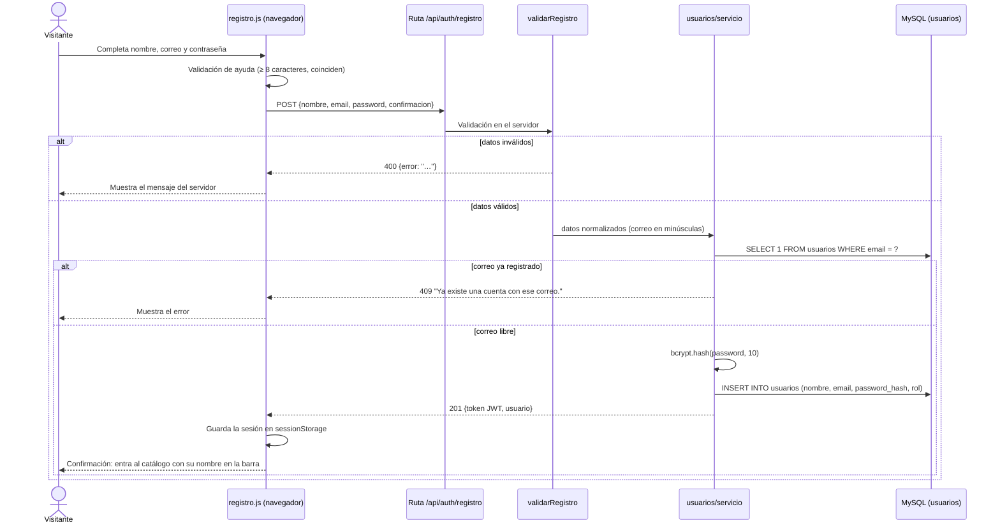
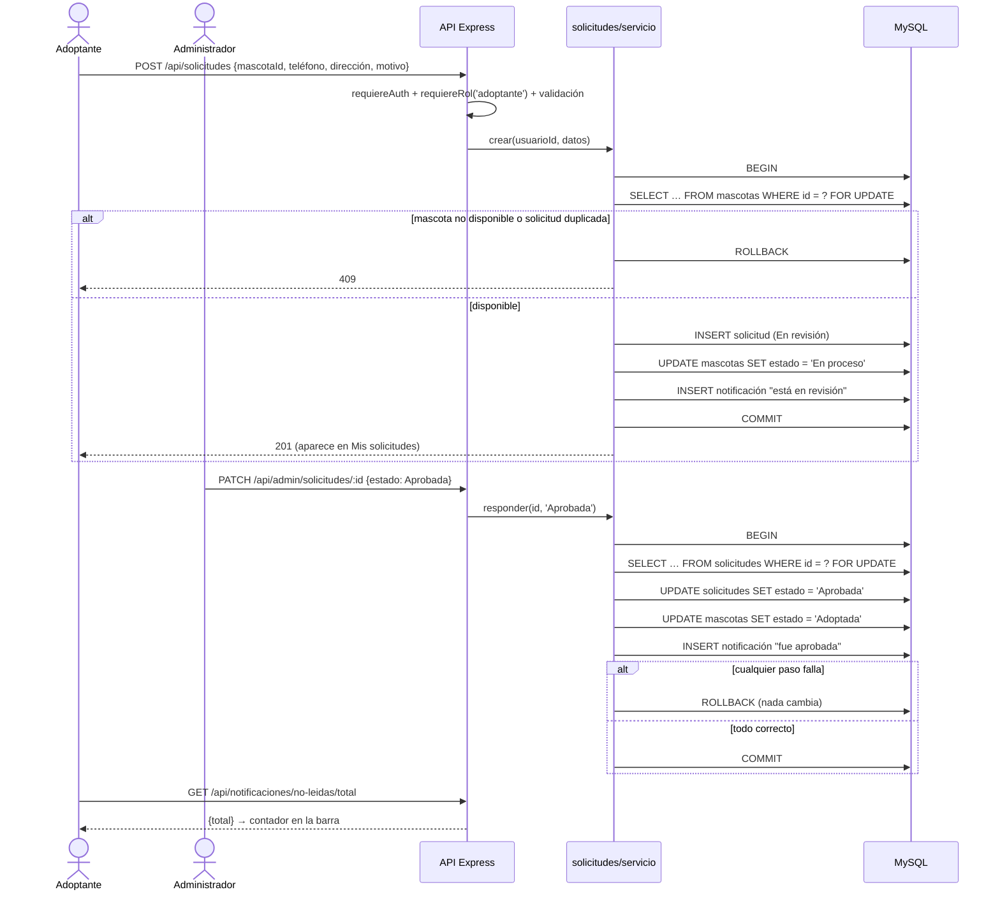

# 3. Funcionalidades implementadas

Cada funcionalidad se describe con la misma estructura: requisito, interfaz, lógica de negocio, datos, resultado (con su evidencia) y manejo de errores. Las capturas están en [`docs/evidencias/`](evidencias/) y las pruebas en [`06_pruebas.md`](06_pruebas.md).

## 3.1 Registro de adoptantes

| Aspecto | Detalle |
|---|---|
| **Requisito implementado** | RF-01 (y RNF-02) |
| **Interfaz** | `registro.html` + [`public/js/paginas/registro.js`](../public/js/paginas/registro.js) |
| **Lógica** | `POST /api/auth/registro` → [`usuarios/servicio.js`](../src/modules/usuarios/servicio.js): valida nombre (≥ 2), formato de correo y contraseña (8 a 72 bytes); normaliza el correo a minúsculas; comprueba que no exista; guarda la contraseña con **bcrypt** (10 rondas); asigna el rol *adoptante* y devuelve un JWT para iniciar sesión directamente |
| **Datos** | Tabla `usuarios` (`email UNIQUE`, `password_hash`). `SELECT 1 FROM usuarios WHERE email = ?` → `INSERT INTO usuarios (...) VALUES (?, ?, ?, ?)` |
| **Resultado** | 201 con token y datos públicos (nunca el hash). Evidencia: PR-01, [`PR-01_registro_exitoso.png`](evidencias/PR-01_registro_exitoso.png) |
| **Manejo de errores** | 400 con todos los motivos de validación (PR-03); 409 "Ya existe una cuenta con ese correo." (PR-02, [captura](evidencias/PR-02_registro_correo_duplicado.png)), también si dos registros llegan a la vez (`ER_DUP_ENTRY`); el navegador repite las validaciones para orientar al usuario |

## 3.2 Inicio de sesión

| Aspecto | Detalle |
|---|---|
| **Requisito implementado** | RF-02 (corrige el hallazgo 3) |
| **Interfaz** | `login.html` + [`public/js/paginas/login.js`](../public/js/paginas/login.js); la sesión se guarda en `sessionStorage` (token, id, nombre, rol y vencimiento) mediante [`public/js/comun.js`](../public/js/comun.js) |
| **Lógica** | `POST /api/auth/login`: busca al usuario por correo, compara con `bcrypt.compare` (también contra un hash simulado si el correo no existe, para no revelar qué dato falló) y firma un JWT HS256 con `sub` = id y `rol`, válido por `JWT_EXPIRA` (4 h). Límite de 5 intentos fallidos cada 15 minutos. Si ya hay sesión, Login y Registro redirigen al catálogo o al panel |
| **Datos** | `SELECT ..., password_hash FROM usuarios WHERE email = ?` |
| **Resultado** | 200 con token; el administrador va al panel y el adoptante al catálogo. Evidencia: PR-04, [`PR-04_login_valido_admin.png`](evidencias/PR-04_login_valido_admin.png) |
| **Manejo de errores** | 401 genérico "Correo o contraseña incorrectos." (PR-05, [captura](evidencias/PR-05_login_error.png)); 429 tras 5 intentos fallidos (PR-06); un token vencido o alterado responde 401 y el frontend cierra la sesión y vuelve al login |

## 3.3 Catálogo de mascotas

| Aspecto | Detalle |
|---|---|
| **Requisito implementado** | RF-03, PB-16 |
| **Interfaz** | `catalogo-publico.html` (visitantes) y `catalogo.html` (con sesión), ambos con [`public/js/paginas/catalogo.js`](../public/js/paginas/catalogo.js) |
| **Lógica** | `GET /api/mascotas?estado=Disponible,En proceso&tipoId=&q=` (público). Por defecto el catálogo muestra solo *Disponibles* y *En proceso* (estas al final); el filtro *Ver adoptadas* cambia a `estado=Adoptada` con el título "Mascotas adoptadas". Los filtros de tipo se generan con `GET /api/tipos-mascota?activos=1&conMascotas=1&estado=…`, contando solo las mascotas de la vista actual, así que un tipo nuevo o desactivado se refleja sin cambiar código. La búsqueda se hace en el servidor y escapa los comodines `%` y `_` |
| **Datos** | `mascotas` ⋈ `tipos_mascota`, ordenadas por estado (Disponible primero) y nombre; índice `ix_mascotas_estado_tipo` |
| **Resultado** | Tarjetas con foto real (o el ícono del tipo), edad, tipo y estado. Evidencia: PR-07 y PR-28, [`PR-07_catalogo_filtro_gato.png`](evidencias/PR-07_catalogo_filtro_gato.png), [`PR-28_catalogo_sin_adoptadas.png`](evidencias/PR-28_catalogo_sin_adoptadas.png), [`PR-28_ver_adoptadas.png`](evidencias/PR-28_ver_adoptadas.png) |
| **Manejo de errores** | Filtro de tipo o estado inválido → 400; sin resultados → "No se encontraron mascotas con ese criterio."; si la API no responde se muestra el mensaje de conexión |

## 3.4 Ficha de detalle

| Aspecto | Detalle |
|---|---|
| **Requisito implementado** | RF-04 |
| **Interfaz** | `detalle.html` + [`public/js/paginas/detalle.js`](../public/js/paginas/detalle.js) — ahora pública (antes exigía sesión aunque el catálogo público enlazaba a ella) |
| **Lógica** | `GET /api/mascotas/:id`. El botón depende del estado y del rol: *Solicitar adopción* (adoptante y mascota disponible), *Inicia sesión para solicitar* (visitante), *En proceso de adopción* deshabilitado (en proceso), el aviso *"Esta mascota ya encontró un hogar"* sin botón (adoptada), y sin botón para el administrador |
| **Datos** | `SELECT ... FROM mascotas m JOIN tipos_mascota t ... WHERE m.id = ?` |
| **Resultado** | Foto, tipo, raza, edad, sexo, descripción y estado. Evidencia: PR-08, [`PR-08_detalle_mascota.png`](evidencias/PR-08_detalle_mascota.png), [`pantalla_movil_detalle.png`](evidencias/pantalla_movil_detalle.png) |
| **Manejo de errores** | Id no numérico → 400; mascota inexistente → 404 "Mascota no encontrada." con enlace de regreso al catálogo |

## 3.5 Enviar solicitud de adopción

| Aspecto | Detalle |
|---|---|
| **Requisito implementado** | RF-06 (completa PB-08 en el servidor) |
| **Interfaz** | `solicitar.html` + [`public/js/paginas/solicitar.js`](../public/js/paginas/solicitar.js) |
| **Lógica** | `POST /api/solicitudes` (solo adoptantes). Valida teléfono `8888-1234`, dirección (≥ 5) y motivo (≥ 10). **Transacción:** bloquea la mascota con `SELECT … FOR UPDATE`, rechaza si no está *Disponible* o si ya hay una solicitud activa, inserta la solicitud *En revisión*, cambia la mascota a *En proceso* y crea la notificación |
| **Datos** | `mascotas`, `solicitudes` (`CHECK` del teléfono, `UNIQUE mascota_en_revision`), `notificaciones` |
| **Resultado** | 201; la solicitud aparece de inmediato en *Mis solicitudes* con aviso de envío. Evidencia: PR-14, [`PR-14_solicitud_enviada.png`](evidencias/PR-14_solicitud_enviada.png) |
| **Manejo de errores** | 400 por teléfono u otros campos (PR-15, [captura](evidencias/PR-15_telefono_invalido.png)); 409 si la mascota ya no está disponible (PR-16, [captura](evidencias/PR-16_mascota_no_disponible.png)); dos solicitudes simultáneas: solo una se guarda (PR-20); cualquier fallo intermedio → `ROLLBACK` |

## 3.6 Seguimiento de la solicitud

| Aspecto | Detalle |
|---|---|
| **Requisito implementado** | RF-05, RNF-01 |
| **Interfaz** | `seguimiento.html` + [`public/js/paginas/seguimiento.js`](../public/js/paginas/seguimiento.js): línea de tiempo Solicitada → En revisión → Aprobada/Rechazada, fechas de solicitud y respuesta, y datos enviados |
| **Lógica** | `GET /api/solicitudes/:id`: solo su dueño o un administrador pueden verla |
| **Datos** | `solicitudes` ⋈ `mascotas` ⋈ `tipos_mascota` ⋈ `usuarios` por id (clave primaria) |
| **Resultado** | Responde en menos de 2 s (≈12 ms medido). Evidencia: PR-21, [`PR-21_seguimiento_en_revision.png`](evidencias/PR-21_seguimiento_en_revision.png), [`PR-18_seguimiento_aprobada.png`](evidencias/PR-18_seguimiento_aprobada.png) |
| **Manejo de errores** | Solicitud de otra persona → 403 "No tienes permiso para ver esta solicitud."; inexistente → 404 |

## 3.7 Historial de solicitudes propias

| Aspecto | Detalle |
|---|---|
| **Requisito implementado** | RF-10 |
| **Interfaz** | `mis-solicitudes.html` + [`public/js/paginas/mis-solicitudes.js`](../public/js/paginas/mis-solicitudes.js) |
| **Lógica** | `GET /api/solicitudes/mias`: solo las del usuario del token, de la más reciente a la más antigua |
| **Datos** | `SELECT ... FROM solicitudes ... WHERE s.usuario_id = ? ORDER BY s.fecha DESC`; índice `ix_solicitudes_usuario (usuario_id, fecha)` |
| **Resultado** | Tarjetas con foto, número de solicitud, fecha y estado; cada una abre su seguimiento. Evidencia: PR-14 |
| **Manejo de errores** | Sin solicitudes → mensaje con enlace al catálogo; sin sesión → 401 y redirección al login |

## 3.8 Revisar y responder solicitudes (administrador)

| Aspecto | Detalle |
|---|---|
| **Requisito implementado** | RF-08, RNF-04 |
| **Interfaz** | Sección "Solicitudes pendientes" de `admin.html` ([`public/js/paginas/admin.js`](../public/js/paginas/admin.js)), con solicitante, correo, teléfono, motivo y confirmación antes de responder |
| **Lógica** | `GET /api/admin/solicitudes?estado=En revisión` y `PATCH /api/admin/solicitudes/:id` (solo admin). **Transacción:** bloquea la solicitud (debe estar *En revisión*) y la mascota, actualiza la solicitud, cambia la mascota a *Adoptada* o *Disponible* y crea la notificación |
| **Datos** | `solicitudes`, `mascotas`, `notificaciones` (`UNIQUE mascota_aprobada`) |
| **Resultado** | La mascota cambia de estado y el adoptante recibe la notificación. Evidencia: PR-18, [`PR-18_solicitud_aprobada.png`](evidencias/PR-18_solicitud_aprobada.png) |
| **Manejo de errores** | Adoptante → 403 (PR-17); solicitud ya respondida → 409; fallo en cualquier paso → `ROLLBACK` sin cambios (PR-19) |

## 3.9 Gestión del catálogo, tipos y fotos (administrador)

| Aspecto | Detalle |
|---|---|
| **Requisito implementado** | RF-09, PB-10, PB-16 (cierra el hallazgo 4) |
| **Interfaz** | Secciones "Gestión de mascotas" y "Tipos de mascota" de `admin.html`: agregar y editar mascotas (incluido el estado), subir, reemplazar o quitar la foto con vista previa, y agregar, editar, activar o desactivar tipos |
| **Lógica** | `POST`/`PUT /api/mascotas` (`multipart/form-data`) y `POST`/`PUT /api/tipos-mascota`, solo admin. Reglas: el tipo debe existir y estar activo; *En proceso* solo lo asigna una solicitud; no se cambia el estado de una mascota con solicitud *En revisión* o *Aprobada*; las fotos deben ser JPG, PNG o WEBP de hasta 2 MB y se verifica su firma binaria |
| **Datos** | `mascotas` (`foto_url`), `tipos_mascota` (`UNIQUE nombre`, `activo`); archivos en `uploads/mascotas/` |
| **Resultado** | Los cambios se ven al instante en el catálogo y el detalle. Evidencia: PR-11 ([formulario](evidencias/PR-11_formulario_con_vista_previa.png), [resultado](evidencias/PR-11_mascota_con_foto.png)), PR-13 ([captura](evidencias/PR-13_tipo_desactivado.png)), [`pantalla_panel_admin.png`](evidencias/pantalla_panel_admin.png) |
| **Manejo de errores** | Tipo duplicado → 409 (PR-09, [captura](evidencias/PR-09_tipo_duplicado.png)); foto inválida → 400 y el archivo se borra (PR-12, [captura](evidencias/PR-12_foto_invalida.png)); cambio de estado no permitido → 409; adoptante → 403 (PR-10) |

## 3.10 Notificaciones

| Aspecto | Detalle |
|---|---|
| **Requisito implementado** | RF-07, PB-09 (como notificaciones internas; el correo queda fuera de alcance) |
| **Interfaz** | Contador de no leídas en la barra y `notificaciones.html` ([`public/js/paginas/notificaciones.js`](../public/js/paginas/notificaciones.js)) con las no leídas destacadas, fechas relativas, enlace al seguimiento y botones para marcarlas |
| **Lógica** | Las notificaciones se crean **dentro** de las transacciones de solicitudes (enviar, aprobar o rechazar). `GET /api/notificaciones`, `GET /api/notificaciones/no-leidas/total`, `PATCH /api/notificaciones/:id/leida` (solo el dueño) y `PATCH /api/notificaciones/leidas` |
| **Datos** | `notificaciones` (`leida`, índice `ix_notificaciones_usuario_leida`) |
| **Resultado** | El adoptante ve el resultado de su solicitud y el contador baja al leerla. Evidencia: PR-22, [`PR-22_notificaciones.png`](evidencias/PR-22_notificaciones.png) |
| **Manejo de errores** | Notificación de otra persona → 403; inexistente → 404; sin sesión → 401 (PR-23) |

---

## 3.11 Flujo completo 1: Registro → Validación → Almacenamiento → Confirmación

| Etapa | Dónde ocurre | Qué se verifica o guarda |
|---|---|---|
| Registro | `registro.html` | El visitante completa el formulario |
| Validación | Navegador (ayuda) y **servidor** (`validaciones.js`) | Nombre, formato de correo, longitud de la contraseña, confirmación |
| Almacenamiento | `usuarios/servicio.js` → tabla `usuarios` | Correo único, contraseña solo como hash bcrypt |
| Confirmación | Respuesta 201 + redirección | Sesión iniciada con token; barra con "Salir (Ana)" ([captura](evidencias/PR-01_registro_exitoso.png)) |

## 3.12 Flujo completo 2: Solicitud → Procesamiento → Cambio de estado → Notificación

| Etapa | Dónde ocurre | Resultado |
|---|---|---|
| Solicitud | `solicitar.html` → `POST /api/solicitudes` | Datos validados en el navegador y en el servidor |
| Procesamiento | `solicitudes/servicio.js`, transacción 1 | Solicitud *En revisión*; la mascota queda bloqueada para otros ([captura](evidencias/PR-14_solicitud_enviada.png)) |
| Cambio de estado | Panel → `PATCH /api/admin/solicitudes/:id`, transacción 2 | Solicitud *Aprobada* o *Rechazada*; mascota *Adoptada* o *Disponible* ([captura](evidencias/PR-18_solicitud_aprobada.png)) |
| Notificación | Dentro de la misma transacción | El adoptante ve el contador y el mensaje ([captura](evidencias/PR-22_notificaciones.png)) y su seguimiento en *Aprobada* ([captura](evidencias/PR-18_seguimiento_aprobada.png)) |
