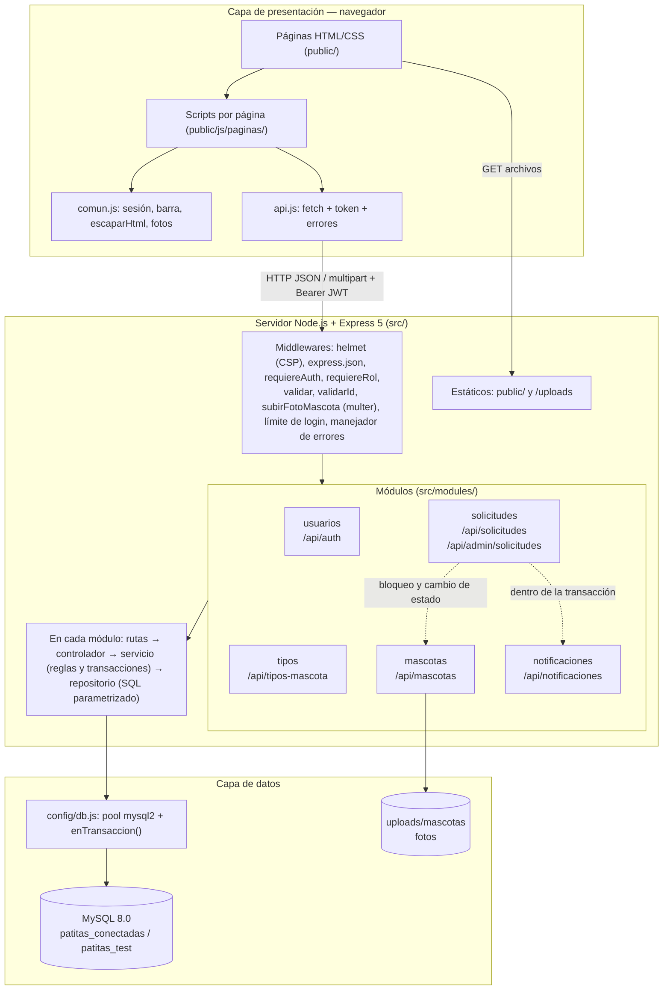

# 4. Arquitectura actualizada

## 4.1 Decisiones y cambios respecto al Hito 1

| Aspecto | Hito 1 (propuesta) | Segundo Parcial (implementado) | Justificación |
|---|---|---|---|
| Estilo | Cliente-servidor por capas, monolito modular | **Se mantiene** | Sigue siendo adecuado para un solo refugio y un equipo de una persona |
| Backend | Node.js + Express | **Node.js + Express 5** (API REST) en capas `routes → controller → service → repository` | Se conserva; Express 5 maneja de forma nativa los errores de funciones `async` |
| Base de datos | MongoDB | **MySQL 8.0** (el Hito 1 mencionaba XAMPP; se usó el MySQL 8.0 instalado) con `mysql2/promise` y pool de conexiones | El dominio es relacional (solicitud = usuario + mascota) y la rúbrica exige `CREATE TABLE`, PK, FK, UNIQUE, NOT NULL, integridad referencial y transacciones, que un motor relacional demuestra directamente |
| Frontend | React (SPA) | **HTML + CSS + JavaScript** del prototipo, servido por Express y consumiendo la API con `fetch` | El prototipo ya estaba validado con usuarios (evaluación heurística del Hito 1); reescribirlo en React no aporta a los requisitos de esta etapa y consumiría el tiempo de backend, pruebas y migración |
| Datos en el navegador | localStorage como base de datos (usuarios y contraseñas en texto plano) | Solo un token JWT y datos mínimos de sesión en `sessionStorage` | Cumple RNF-02 y la retroalimentación del docente |
| Tipos de mascota | Lista fija (Perro, Gato) | Tabla catálogo `tipos_mascota` administrable | El refugio puede recibir aves, conejos u otros animales sin cambiar código |

## 4.2 Diagrama de capas y módulos



**Responsabilidad de cada capa**

| Capa | Archivos | Responsabilidad |
|---|---|---|
| Rutas | `src/modules/*/rutas.js` | Define los endpoints y encadena autenticación, rol, validación y subida |
| Controlador | `src/modules/*/controlador.js` | Traduce la petición HTTP (params, query, body, archivo) y devuelve el código y el JSON |
| Servicio | `src/modules/*/servicio.js` | Reglas de negocio, transacciones (`enTransaccion`) y errores de dominio (`ErrorApp`) |
| Repositorio | `src/modules/*/repositorio.js` | Única capa con SQL; consultas parametrizadas; recibe la conexión de la transacción cuando corresponde |
| Transversal | `src/middlewares/`, `src/utils/`, `src/config/` | Seguridad, validación, manejo central de errores, configuración por entorno |

## 4.3 Estructura de carpetas

```
patitas-conectadas/
├─ src/
│  ├─ app.js                 Express: helmet, JSON, rutas, estáticos, errores
│  ├─ server.js              Arranque (verifica la conexión a MySQL)
│  ├─ config/                entorno.js (.env, BD según NODE_ENV), db.js (pool, enTransaccion)
│  ├─ middlewares/           autenticacion, validar, validarId, subida, errores
│  ├─ modules/               usuarios, tipos, mascotas, solicitudes, notificaciones
│  └─ utils/                 ErrorApp, validadores, token (JWT), archivos (fotos)
├─ public/                   Prototipo evolucionado: páginas HTML, css/, js/comun.js, js/api.js, js/paginas/
├─ database/                 01_schema.sql, 02_seed.sql, generar-seed.js, instalar.js, seed-fotos/, migracion/
├─ tests/                    Jest + Supertest (PR-01 a PR-35)
├─ scripts/capturas.js       Evidencias con Playwright
└─ docs/                     Documentación del Segundo Parcial, evidencias y documentos v1 (docs/hito1/)
```

## 4.4 Seguridad

| Riesgo | Medida implementada | Dónde |
|---|---|---|
| Contraseñas expuestas | Hash **bcrypt** (10 rondas); nunca se devuelve `password_hash`; el navegador no guarda contraseñas | `usuarios/servicio.js`, `public/js/comun.js` |
| Acceso indebido | **JWT** HS256 con vencimiento (`JWT_EXPIRA`); `requiereAuth` (401) y `requiereRol('admin')` (403) en toda ruta de modificación (RNF-04) | `middlewares/autenticacion.js` |
| Fuerza bruta en el login | Máximo 5 intentos fallidos cada 15 minutos (429) y mensaje genérico | `usuarios/rutas.js` |
| Datos inválidos | Validación en el **servidor** de todos los campos, más `CHECK`, `UNIQUE`, `NOT NULL` y `FOREIGN KEY` en la base de datos | `*/validaciones.js`, `database/01_schema.sql` |
| Inyección SQL | Solo consultas parametrizadas (`?`); sin concatenar datos del usuario | `*/repositorio.js` |
| XSS | `escaparHtml` en toda interpolación sobre `innerHTML`; **CSP estricta de Helmet** sin `'unsafe-inline'` (todos los scripts están en archivos) | `public/js/comun.js`, `src/app.js` |
| Archivos maliciosos | Solo JPG, PNG o WEBP de hasta 2 MB; verificación de la firma binaria; nombre aleatorio (UUID); rutas con `../` responden 404 | `middlewares/subida.js` |
| Fuga de detalles internos | Manejador central: respuestas `{ error }` coherentes, nunca el stack ni el SQL | `middlewares/errores.js` |
| Secretos en el repositorio | `.env` excluido de Git; solo se sube `.env.example` | `.gitignore` |
| Privilegios excesivos en la BD | Usuario **`patitas_app`** de mínimo privilegio (ver abajo) | MySQL |

### Usuario de base de datos con mínimo privilegio

La aplicación, las pruebas y la migración se conectan con **`patitas_app`**, nunca con `root`:

```sql
GRANT ALL PRIVILEGES ON patitas_conectadas.* TO 'patitas_app'@'localhost';
GRANT ALL PRIVILEGES ON patitas_test.*       TO 'patitas_app'@'localhost';
GRANT PROCESS ON *.* TO 'patitas_app'@'localhost';
```

- Si la aplicación se viera comprometida, no podría leer otras bases de datos del servidor ni crear usuarios.
- `PROCESS` es el único privilegio global, y lo necesita `mysqldump` para el respaldo previo a la migración, que además se ejecuta con `--no-tablespaces`.
- Se verificó con `SHOW GRANTS` que estos son exactamente sus permisos.

Detalle en [`05_base_datos.md` §5.7](05_base_datos.md).

## 4.5 Matriz de trazabilidad actualizada

| RF | Pantalla | Endpoint | Módulo | Tabla | Prueba |
|---|---|---|---|---|---|
| RF-01 Registro | Registro (`registro.html`) | `POST /api/auth/registro` | usuarios | `usuarios` | PR-01, PR-02, PR-03 |
| RF-02 Inicio de sesión | Login (`login.html`) | `POST /api/auth/login`, `GET /api/auth/perfil` | usuarios | `usuarios` | PR-04, PR-05, PR-06 |
| RF-03 Catálogo | Catálogo (`catalogo.html`, `catalogo-publico.html`) | `GET /api/mascotas?estado=Disponible,En proceso` (o `estado=Adoptada` con *Ver adoptadas*), `GET /api/tipos-mascota` | mascotas, tipos | `mascotas`, `tipos_mascota` | PR-07, PR-28 |
| RF-04 Detalle | Detalle (`detalle.html`) | `GET /api/mascotas/:id` | mascotas | `mascotas`, `tipos_mascota` | PR-08, PR-28 |
| RF-05 Seguimiento | Seguimiento (`seguimiento.html`) | `GET /api/solicitudes/:id` | solicitudes | `solicitudes`, `mascotas`, `usuarios` | PR-21 |
| RF-06 Enviar solicitud | Solicitar (`solicitar.html`) | `POST /api/solicitudes` | solicitudes | `solicitudes`, `mascotas`, `notificaciones` | PR-14, PR-15, PR-16, PR-20 |
| RF-07 Notificaciones | Notificaciones (`notificaciones.html`) y contador en la barra | `GET /api/notificaciones`, `GET /api/notificaciones/no-leidas/total`, `PATCH /api/notificaciones/:id/leida`, `PATCH /api/notificaciones/leidas` | notificaciones | `notificaciones` | PR-18, PR-22, PR-23 |
| RF-08 Responder solicitudes | Panel de Administración (`admin.html`) | `GET /api/admin/solicitudes`, `PATCH /api/admin/solicitudes/:id` | solicitudes | `solicitudes`, `mascotas`, `notificaciones` | PR-17, PR-18, PR-19 |
| RF-09 Gestionar catálogo | Panel de Administración (`admin.html`) | `POST`/`PUT /api/mascotas`, `POST`/`PUT /api/tipos-mascota` | mascotas, tipos | `mascotas`, `tipos_mascota` | PR-09, PR-10, PR-11, PR-12, PR-13 |
| RF-10 Historial propio | Mis Solicitudes (`mis-solicitudes.html`) | `GET /api/solicitudes/mias` | solicitudes | `solicitudes` | PR-14 |

| RNF | Cómo se cumple | Prueba |
|---|---|---|
| RNF-01 Seguimiento en menos de 2 s | Consulta por clave primaria con índices; ≈12 ms medido | PR-21 |
| RNF-02 Contraseñas cifradas | bcrypt en la API y en la migración | PR-01, PR-25 |
| RNF-03 Responsive | CSS con `@media`, etiqueta `viewport` en todas las páginas | [`pantalla_movil_catalogo.png`](evidencias/pantalla_movil_catalogo.png) |
| RNF-04 Solo el admin modifica | `requiereAuth` + `requiereRol('admin')` | PR-10, PR-17 |
