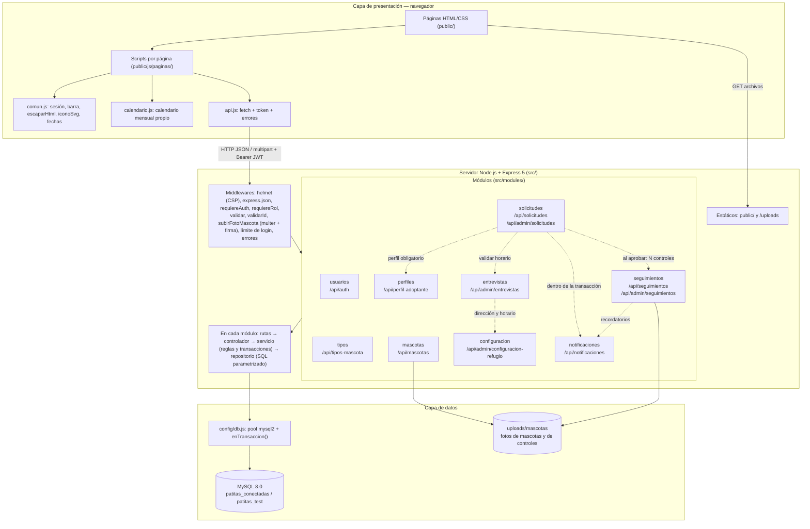
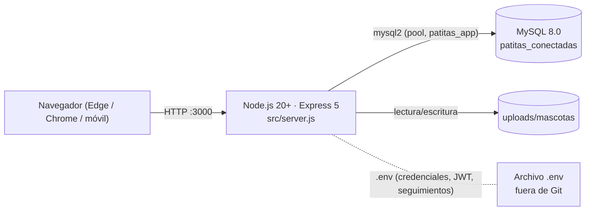
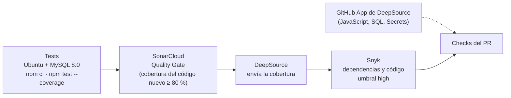

# 4. Arquitectura

> Versión 3.0 — III Parcial (`v1.0.0`). Corresponde al código de `main` al 2026-11-07.

## 4.1 Decisiones y cambios respecto al Hito 1

| Aspecto | Hito 1 (propuesta) | Implementado (`v1.0.0`) | Justificación |
|---|---|---|---|
| Estilo | Cliente-servidor por capas, monolito modular | **Se mantiene** | Adecuado para un solo refugio y un equipo de una persona |
| Backend | Node.js + Express | **Node.js + Express 5** (API REST) en capas `rutas → controlador → servicio → repositorio` | Express 5 maneja de forma nativa los errores de funciones `async` |
| Base de datos | MongoDB | **MySQL 8.0** con `mysql2/promise`, pool de conexiones y **migraciones numeradas** | El dominio es relacional (solicitud = usuario + mascota; entrevista y controles de una solicitud) y las reglas necesitan FK, UNIQUE, CHECK y transacciones |
| Frontend | React (SPA) | **HTML + CSS + JavaScript** del prototipo, servido por Express y consumiendo la API con `fetch` | El prototipo ya estaba validado con usuarios; la CSP estricta impide librerías externas, así que el calendario es un componente propio |
| Datos en el navegador | localStorage como base de datos | Solo el token JWT y datos mínimos de sesión en `sessionStorage` | RNF-02 y la retroalimentación del docente |
| Tipos de mascota | Lista fija | Tabla `tipos_mascota` administrable (sin la columna `icono` desde la migración 001) | Animales nuevos sin cambiar código |
| Proceso de adopción | Solicitud → aprobar/rechazar | **Perfil → Solicitada → Entrevista programada → Entrevistada → Aprobada/Rechazada → controles post-adopción** | Visión original del refugio (ampliación del III Parcial, RF-11 a RF-15) |
| Iconos | Emojis | **SVG en línea** (`iconoSvg`) con `currentColor`; solo la huella del logo es emoji | Consistencia visual y accesibilidad (`aria-hidden`); los emojis cambian según el sistema operativo |

## 4.2 Diagrama de capas y módulos



**Responsabilidad de cada capa**

| Capa | Archivos | Responsabilidad |
|---|---|---|
| Rutas | `src/modules/*/rutas.js` | Endpoints; encadenan autenticación, rol, validación y subida |
| Controlador | `src/modules/*/controlador.js` | Traduce la petición HTTP (params, query, body, archivo) y devuelve el código y el JSON |
| Servicio | `src/modules/*/servicio.js` | Reglas de negocio, transacciones (`enTransaccion`) y errores de dominio (`ErrorApp`) |
| Repositorio | `src/modules/*/repositorio.js` | Única capa con SQL; consultas parametrizadas; recibe la conexión de la transacción |
| Transversal | `src/middlewares/`, `src/utils/` (`fechas.js`, `validadores.js`, `archivos.js`, `token.js`), `src/config/` | Seguridad, validación, errores, fechas en texto, configuración por entorno |

**Dependencias entre módulos:** los servicios usan repositorios de otros módulos (por ejemplo, `solicitudes/servicio` usa `mascotas/repositorio` y `entrevistas/repositorio` dentro de la misma transacción) o servicios de módulos de menor nivel (`perfiles`, `entrevistas`, `seguimientos`). No hay dependencias circulares: `seguimientos` solo importa el **repositorio** de solicitudes.

## 4.3 Estructura de carpetas

```
patitas-conectadas/
├─ src/
│  ├─ app.js                 Express: helmet, JSON, rutas, estáticos, errores
│  ├─ server.js              Arranque (verifica la conexión a MySQL)
│  ├─ config/                entorno.js (.env, BD según NODE_ENV, seguimientos), db.js (pool, enTransaccion)
│  ├─ middlewares/           autenticacion, validar, validarId, subida, errores
│  ├─ modules/               usuarios, perfiles, tipos, mascotas, solicitudes, entrevistas,
│  │                         configuracion, seguimientos, notificaciones
│  └─ utils/                 ErrorApp, validadores, fechas, token (JWT), archivos (fotos)
├─ public/                   Páginas HTML, css/, js/comun.js, js/api.js, js/calendario.js, js/paginas/
├─ database/                 01_schema.sql, migraciones/ (001–004), 02_seed.sql, datos-semilla.js,
│                            generar-seed.js, instalar.js, migrar-esquema.js, seed-fotos/, migracion/ (ETL)
├─ tests/                    Jest + Supertest (PR-01 a PR-50) y e2e/ (Playwright, E2E-01 a E2E-16)
├─ scripts/                  capturas, capturas-manual, medir-tiempos, recordatorios
├─ .github/workflows/ci.yml  Pipeline de calidad y seguridad
└─ docs/                     Documentación (00 a 23), evidencias/ y docs/hito1/
```

## 4.4 Seguridad

| Riesgo | Medida implementada | Dónde |
|---|---|---|
| Contraseñas expuestas | Hash **bcrypt** (10 rondas); nunca se devuelve `password_hash`; el navegador no guarda contraseñas | `usuarios/servicio.js` |
| Acceso indebido | **JWT** HS256 con vencimiento (`JWT_EXPIRA`); `requiereAuth` (401) y `requiereRol` (403) en toda ruta de modificación o de administración (RNF-04); el adoptante solo ve sus solicitudes, controles y perfil | `middlewares/autenticacion.js`, servicios |
| Fuerza bruta en el login | Máximo 5 intentos fallidos cada 15 minutos (429) y mensaje genérico | `usuarios/rutas.js` |
| Datos inválidos | Validación en el **servidor** de todos los campos, más `CHECK`, `UNIQUE`, `NOT NULL` y `FOREIGN KEY` | `*/validaciones.js`, `database/` |
| Inyección SQL | Solo consultas parametrizadas (`?`) | `*/repositorio.js` |
| XSS | `escaparHtml` en toda interpolación; **CSP estricta de Helmet** sin `'unsafe-inline'`; vista previa de fotos con `data:` (permitido por `img-src 'self' data:`) | `public/js/comun.js`, `src/app.js` |
| Archivos maliciosos | Solo JPG, PNG o WEBP de hasta 2 MB, firma binaria, nombre UUID; el archivo se borra si la petición falla; borrado solo dentro de la carpeta de fotos | `middlewares/subida.js`, `utils/archivos.js` |
| Notas internas | `notas_admin` de la entrevista no se envían al adoptante | `solicitudes/servicio.js` (`obtener`) |
| Fuga de detalles internos | Manejador central: respuestas `{ error }`, nunca el stack ni el SQL | `middlewares/errores.js` |
| Secretos en el repositorio | `.env` excluido; contraseñas demo por variable de entorno y rechazo de los valores `EJEMPLO_` | `.gitignore`, `database/instalar.js` |
| Privilegios excesivos en la BD | Usuario **`patitas_app`** de mínimo privilegio | MySQL |

### Usuario de base de datos con mínimo privilegio

La aplicación, las pruebas, las migraciones y el respaldo se conectan con **`patitas_app`**, nunca con `root`:

```sql
GRANT ALL PRIVILEGES ON patitas_conectadas.* TO 'patitas_app'@'localhost';
GRANT ALL PRIVILEGES ON patitas_test.*       TO 'patitas_app'@'localhost';
GRANT PROCESS ON *.* TO 'patitas_app'@'localhost';
```

- Si la aplicación se viera comprometida, no podría leer otras bases de datos del servidor ni crear usuarios.
- `PROCESS` es el único privilegio global, y lo necesita `mysqldump`, que además se ejecuta con `--no-tablespaces`.
- En el CI se crea el mismo usuario, con una contraseña aleatoria por ejecución.

Detalle en [`05_base_datos.md` §5.7](05_base_datos.md).

## 4.5 Despliegue



- **Entorno probado:** Windows 10, Node v24.20.0, MySQL 8.0.46 locales (un solo servidor). En el CI: Ubuntu, Node 20 y el contenedor `mysql:8.0`.
- **Instalación:** `npm ci` → `.env` → `npm run db:instalar` (esquema, migraciones, seed y fotos) → `npm start`. Verificado desde un clon limpio el 2026-11-07 ([evidencia](evidencias/final/instalacion_desde_cero.txt)).
- **Actualización de una base existente:** respaldo (doc 18) → `npm run db:migrar`.
- **Tareas periódicas:** no hay cron. Los recordatorios se generan al iniciar sesión y al consultar notificaciones; `npm run recordatorios` puede programarse en el Programador de tareas de Windows si se quiere.
- **No incluido:** HTTPS, proxy inverso ni servidor en la nube; el sistema se entrega para uso local o en la red del refugio. Es una limitación documentada en el informe final (doc 21).

## 4.6 Pipeline de integración continua

[`.github/workflows/ci.yml`](../.github/workflows/ci.yml) corre en cada push a `dev` y en cada Pull Request hacia `main`:



- Las credenciales del job (root de MySQL, `patitas_app`, `JWT_SECRET`) se generan en cada ejecución y se enmascaran; las contraseñas demo las genera `tests/configuracion/entorno.js`. Los tokens de las herramientas están en GitHub Secrets.
- **Regla de trabajo:** cada rama se fusiona a `main` con PR (merge commit) cuando Tests, SonarCloud (Quality Gate) y Snyk están en verde. Los checks de DeepSource JavaScript y Test coverage siguen en rojo por falsos positivos documentados (RES-01 en la [bitácora](15_bitacora_defectos.md)).
- Las pruebas E2E (`npm run test:e2e`) se ejecutan localmente porque necesitan Edge o Chrome; su resultado queda en [`evidencias/final/e2e/`](evidencias/final/e2e/).

## 4.7 Decisiones técnicas

| Tema | Decisión | Por qué | Alternativa descartada |
|---|---|---|---|
| **Capas** | `rutas → controlador → servicio → repositorio` por módulo de dominio | Cada capa tiene una sola razón de cambio; el SQL vive solo en los repositorios y las reglas solo en los servicios; las pruebas pueden reemplazar un repositorio (`jest.spyOn`) para forzar fallos de transacción | Lógica en los controladores (más rápido de escribir, imposible de probar por partes) |
| **Validación en el backend** | Cada endpoint valida su cuerpo con una función `validarX` (middleware `validar`) que devuelve `{errores, datos}` normalizados; la BD repite las reglas críticas con `CHECK`/`UNIQUE` | El navegador se puede saltar (E2E-10 y PR-03 lo hacen); la BD es la última defensa ante errores de programación | Solo validación HTML5 o JavaScript |
| **Manejo de errores** | `ErrorApp(status, mensaje)` para errores de dominio; un manejador central traduce `ER_DUP_ENTRY` → 409, `ER_CHECK_CONSTRAINT_VIOLATED` → 400, y todo lo demás → 500 genérico, borrando el archivo subido si lo hubo | Respuestas `{ error }` coherentes y sin filtrar el SQL ni el stack; Express 5 propaga los errores `async` | `try/catch` en cada controlador |
| **Sesiones y tokens** | JWT HS256 firmado con `JWT_SECRET` y vencimiento de 4 h; el cliente lo guarda en `sessionStorage` (se borra al cerrar la pestaña) y lo envía como `Authorization: Bearer`; un 401 lleva al login | API sin estado, sencilla de probar con Supertest | Cookies de sesión en el servidor (requieren almacenamiento de sesiones y protección CSRF) |
| **Hash de contraseñas** | bcrypt con 10 rondas; login con hash señuelo aleatorio para igualar los tiempos y mensaje genérico | Resistente a fuerza bruta; no revela si el correo existe | SHA-256 (demasiado rápido) |
| **Credenciales en `.env`** | Todas las credenciales (BD, JWT, contraseñas demo) en `.env`, fuera de Git; `.env.example` documenta cada variable con valores `EJEMPLO_` que el instalador rechaza | Ningún secreto en el repositorio (DEF-13, DEF-22) | Valores por defecto en el código |
| **Transacciones** | `enTransaccion` con `SELECT ... FOR UPDATE` en las filas que cambian y restricciones UNIQUE sobre columnas generadas como red de seguridad ante la concurrencia | Una aprobación es todo o nada (PR-19, PR-46); dos peticiones simultáneas no pueden ocupar la misma mascota ni el mismo horario (PR-20, PR-39) | Comprobar y luego escribir sin bloqueo (condición de carrera) |
| **Migraciones** | Archivos SQL numerados aplicados en orden y registrados en `migraciones_esquema`; el instalador las aplica siempre | Las pruebas verifican las migraciones en cada ejecución; una base existente se actualiza sin perder datos | Editar `01_schema.sql` y reinstalar (pierde datos) |
| **Fechas** | `DATETIME` sin zona horaria en la hora local del refugio; textos como "martes 10 de noviembre, 10:30 a. m." generados en el servidor (notificaciones) y en el navegador (pantallas) | Un solo refugio en una sola zona horaria | UTC con conversión (innecesario para un refugio) |
| **Seed reproducible** | Fechas como expresiones SQL relativas a `CURDATE()` y contraseñas por marcador | La demo es coherente cualquier día que se instale, sin secretos | Fechas fijas que caducan (la entrevista "futura" quedaría en el pasado) |
| **Recordatorios sin cron** | `INSERT IGNORE ... SELECT` con UNIQUE por control, ejecutado al iniciar sesión, al consultar notificaciones y con `npm run recordatorios` | Sin procesos externos que instalar; no hay duplicados por diseño | Un cron o un `setInterval` en el servidor |
| **Calendario propio** | Componente en `public/js/calendario.js` sin librerías | La CSP estricta solo permite scripts del mismo origen | Librerías de calendario desde un CDN |

### Limitaciones

- Un solo refugio (`configuracion_refugio` tiene una fila) y una sola zona horaria.
- Notificaciones solo internas: no se envían correos ni SMS.
- No hay recuperación de contraseña ni gestión de usuarios administradores desde la interfaz.
- Despliegue local sin HTTPS; el rendimiento solo se midió en local y sin concurrencia (doc 21).

## 4.8 Matriz de trazabilidad

La matriz completa (RF/RNF → pantalla → componente → tabla → caso de prueba → resultado → evidencia → versión) está en [`19_matriz_trazabilidad_final.md`](19_matriz_trazabilidad_final.md).
