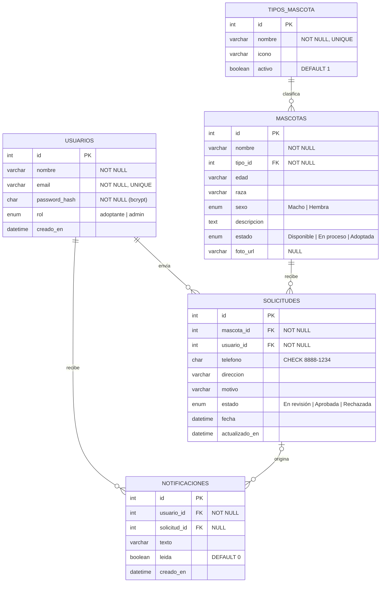

# 5. Base de datos

> Motor: **MySQL 8.0** (servicio local `MySQL80`; el script también es compatible con XAMPP/MariaDB 10.4+).
> Scripts: [`database/01_schema.sql`](../database/01_schema.sql) y [`database/02_seed.sql`](../database/02_seed.sql) (generado por [`database/generar-seed.js`](../database/generar-seed.js)).

## 5.1 Por qué un modelo relacional (cambio respecto al Hito 1)

El Hito 1 proponía MongoDB. Se cambió a MySQL porque el dominio es claramente relacional: una **solicitud** siempre une a un **usuario** con una **mascota**, y una **notificación** pertenece a un usuario y se refiere a una solicitud. Las reglas más importantes del negocio ("no se puede solicitar una mascota que no está disponible", "al aprobar, la mascota queda adoptada y se notifica") necesitan **integridad referencial** y **transacciones**, que un motor relacional garantiza directamente con `FOREIGN KEY`, `UNIQUE`, `CHECK` y `START TRANSACTION / COMMIT / ROLLBACK`.

## 5.2 Diagrama entidad-relación



**Cardinalidades**
- Un usuario envía **0..N** solicitudes; cada solicitud pertenece a **exactamente 1** usuario.
- Una mascota recibe **0..N** solicitudes a lo largo del tiempo, pero solo **una a la vez** puede estar *En revisión* y solo **una** puede quedar *Aprobada*.
- Un tipo de mascota clasifica **0..N** mascotas; cada mascota tiene **exactamente 1** tipo.
- Un usuario recibe **0..N** notificaciones; una notificación se refiere a **0 o 1** solicitud (por ejemplo, "Nueva mascota disponible" no tiene solicitud).

## 5.3 Restricciones

| Restricción | Dónde | Para qué |
|---|---|---|
| **PRIMARY KEY** `AUTO_INCREMENT` | `id` de todas las tablas | Identificador único generado por el motor |
| **UNIQUE** | `usuarios.email` | Impide dos cuentas con el mismo correo (el backend además lo normaliza a minúsculas y responde 409) |
| **UNIQUE** | `tipos_mascota.nombre` | Impide tipos repetidos; con la intercalación `utf8mb4_unicode_ci`, "perro", "Perro" y "PERRO" se consideran el mismo |
| **UNIQUE** sobre columna generada | `solicitudes.mascota_en_revision` | Solo puede existir **una solicitud En revisión por mascota**. Con esto, un usuario tampoco puede tener dos solicitudes activas para la misma mascota, incluso si dos peticiones llegan al mismo tiempo |
| **UNIQUE** sobre columna generada | `solicitudes.mascota_aprobada` | Una mascota no puede quedar aprobada para dos personas |
| **NOT NULL** | Todos los campos obligatorios | El motor rechaza registros incompletos |
| **CHECK** | `solicitudes.telefono REGEXP '^[0-9]{4}-[0-9]{4}$'` | El formato del teléfono también se valida en la base de datos |
| **CHECK** | Longitud mínima de `nombre`, `direccion` (5) y `motivo` (10); formato básico de `email` | Última línea de defensa si la validación del backend fallara |
| **ENUM** | `rol`, `sexo`, `mascotas.estado`, `solicitudes.estado` | Solo se aceptan los valores del flujo definido |
| **FOREIGN KEY** | `mascotas.tipo_id`, `solicitudes.mascota_id`, `solicitudes.usuario_id`, `notificaciones.usuario_id`, `notificaciones.solicitud_id` | Integridad referencial: no hay solicitudes ni notificaciones huérfanas |

Las columnas generadas (`mascota_en_revision`, `mascota_aprobada`) valen el id de la mascota solo cuando la solicitud está en ese estado, y `NULL` en los demás casos. Como `UNIQUE` permite varios `NULL`, el historial puede tener muchas solicitudes rechazadas de la misma mascota, pero nunca dos activas.

## 5.4 Acciones referenciales (`ON DELETE` / `ON UPDATE`)

| Relación | ON DELETE | ON UPDATE | Justificación |
|---|---|---|---|
| `mascotas.tipo_id → tipos_mascota` | **RESTRICT** | CASCADE | No se puede borrar un tipo que tiene mascotas; el administrador lo **desactiva** (`activo = 0`) en lugar de borrarlo |
| `solicitudes.mascota_id → mascotas` | **RESTRICT** | RESTRICT | El historial de adopciones es evidencia del refugio: no se puede borrar una mascota con solicitudes |
| `solicitudes.usuario_id → usuarios` | **RESTRICT** | RESTRICT | No se pierde el historial de un adoptante. `ON UPDATE RESTRICT` es obligatorio aquí porque MySQL no permite `CASCADE` en columnas base de una columna generada almacenada, y los ids `AUTO_INCREMENT` nunca cambian |
| `notificaciones.usuario_id → usuarios` | **CASCADE** | CASCADE | Las notificaciones solo tienen sentido para su dueño; si se elimina la cuenta, se eliminan con ella |
| `notificaciones.solicitud_id → solicitudes` | **SET NULL** | CASCADE | La notificación se conserva como mensaje aunque la solicitud deje de existir |

## 5.5 Índices

| Índice | Consulta que acelera |
|---|---|
| `ix_mascotas_estado_tipo (estado, tipo_id)` | Catálogo filtrado por estado y tipo (RF-03) |
| `ix_mascotas_nombre (nombre)` | Búsqueda por nombre |
| `ix_solicitudes_usuario (usuario_id, fecha)` | Historial propio ordenado por fecha (RF-10) |
| `ix_solicitudes_estado (estado)` | Solicitudes pendientes del panel (RF-08) |
| `ix_notificaciones_usuario_leida (usuario_id, leida, creado_en)` | Lista de notificaciones y contador de no leídas (RF-07) |

## 5.6 Datos semilla

Se generan con `npm run db:seed`, que lee [`database/datos-semilla.js`](../database/datos-semilla.js) y escribe `02_seed.sql` con las contraseñas **hasheadas con bcrypt** (10 rondas). Ningún archivo del repositorio contiene contraseñas en texto plano, salvo las contraseñas demo documentadas en el README.

| Tabla | Registros |
|---|---|
| `tipos_mascota` | 9: Perro, Gato, Ave, Conejo, Cuyo, Hámster, Pez, Tortuga, Otro |
| `usuarios` | 2: Administrador Refugio (`admin@patitas.com`) y Edwin Obando (`edwin.obando@correo.com`) |
| `mascotas` | 10 mascotas reales del refugio: 7 disponibles, 1 en proceso (Mechudo), 2 adoptadas (Encantador y Lara) |
| `solicitudes` | 4 de Edwin: Mechudo *En revisión*, Encantador *Aprobada*, Lara *Aprobada*, Princesa Sucia *Rechazada* (volvió a estar disponible) |
| `notificaciones` | 5, coherentes con las solicitudes, más un aviso de nueva mascota |

Los estados son coherentes: toda mascota *Adoptada* tiene su solicitud *Aprobada* y la mascota *En proceso* tiene su solicitud *En revisión*.

## 5.7 Usuario de base de datos con mínimo privilegio

La aplicación **no usa `root`**. Se conecta con el usuario `patitas_app`, que solo puede trabajar sobre las dos bases de datos del proyecto:

```sql
CREATE USER 'patitas_app'@'localhost' IDENTIFIED BY '<contraseña segura>';
GRANT ALL PRIVILEGES ON patitas_conectadas.* TO 'patitas_app'@'localhost';
GRANT ALL PRIVILEGES ON patitas_test.*       TO 'patitas_app'@'localhost';
GRANT PROCESS ON *.* TO 'patitas_app'@'localhost';
FLUSH PRIVILEGES;
```

- Si la aplicación se viera comprometida, el atacante no podría leer ni modificar otras bases de datos del servidor, ni crear usuarios.
- `PROCESS` es el único privilegio global, y lo necesita `mysqldump` para el respaldo previo a la migración. Además, `mysqldump` se ejecuta con `--no-tablespaces`, para no requerir privilegios adicionales.
- Las credenciales viven solo en `.env` (excluido de Git). En el repositorio solo está `.env.example` con `DB_USER=patitas_app` y la contraseña vacía.
