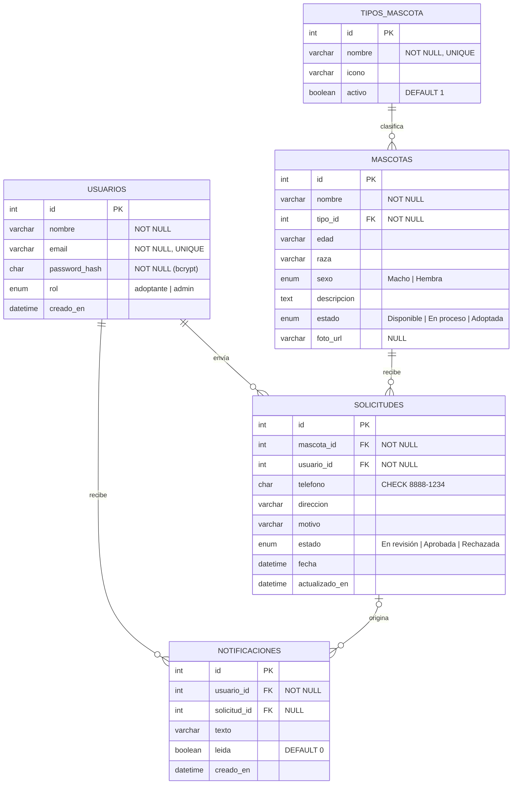

# 5. Base de datos

> Motor: **MySQL 8.0** (servicio local `MySQL80`). Todo se probó con MySQL 8.0. El script usa columnas generadas, `CHECK` con `REGEXP` y `utf8mb4`, disponibles también en MariaDB 10.4+ (la de XAMPP), pero **no se probó con XAMPP/MariaDB**.
> Scripts: [`database/01_schema.sql`](../database/01_schema.sql) y [`database/02_seed.sql`](../database/02_seed.sql) (generado por [`database/generar-seed.js`](../database/generar-seed.js)).

## 5.1 Por qué un modelo relacional (cambio respecto al Hito 1)

El Hito 1 proponía MongoDB. Se cambió a MySQL porque el dominio es claramente relacional: una **solicitud** siempre une a un **usuario** con una **mascota**, y una **notificación** pertenece a un usuario y se refiere a una solicitud. Las reglas más importantes del negocio ("no se puede solicitar una mascota que no está disponible", "al aprobar, la mascota queda adoptada y se notifica") necesitan **integridad referencial** y **transacciones**, que un motor relacional garantiza directamente con `FOREIGN KEY`, `UNIQUE`, `CHECK` y `START TRANSACTION / COMMIT / ROLLBACK`.

## 5.2 Diagrama entidad-relación



**Cardinalidades**
- Un usuario envía **0..N** solicitudes; cada solicitud pertenece a **exactamente 1** usuario.
- Una mascota recibe **0..N** solicitudes a lo largo del tiempo, pero solo **una a la vez** puede estar *En revisión* y solo **una** puede quedar *Aprobada*.
- Un tipo de mascota clasifica **0..N** mascotas; cada mascota tiene **exactamente 1** tipo.
- Un usuario recibe **0..N** notificaciones; una notificación se refiere a **0 o 1** solicitud (por ejemplo, "Nueva mascota disponible" no tiene solicitud).

## 5.3 Restricciones

| Restricción | Dónde | Para qué |
|---|---|---|
| **PRIMARY KEY** `AUTO_INCREMENT` | `id` de todas las tablas | Identificador único generado por el motor |
| **UNIQUE** | `usuarios.email` | Impide dos cuentas con el mismo correo (el backend además lo normaliza a minúsculas y responde 409) |
| **UNIQUE** | `tipos_mascota.nombre` | Impide tipos repetidos; con la intercalación `utf8mb4_unicode_ci`, "perro", "Perro" y "PERRO" se consideran el mismo |
| **UNIQUE** sobre columna generada | `solicitudes.mascota_en_revision` | Solo puede existir **una solicitud En revisión por mascota**. Con esto, un usuario tampoco puede tener dos solicitudes activas para la misma mascota, incluso si dos peticiones llegan al mismo tiempo |
| **UNIQUE** sobre columna generada | `solicitudes.mascota_aprobada` | Una mascota no puede quedar aprobada para dos personas |
| **NOT NULL** | Todos los campos obligatorios | El motor rechaza registros incompletos |
| **CHECK** | `solicitudes.telefono REGEXP '^[0-9]{4}-[0-9]{4}$'` | El formato del teléfono también se valida en la base de datos |
| **CHECK** | Longitud mínima de `nombre`, `direccion` (5) y `motivo` (10); formato básico de `email` | Última línea de defensa si la validación del backend fallara |
| **ENUM** | `rol`, `sexo`, `mascotas.estado`, `solicitudes.estado` | Solo se aceptan los valores del flujo definido |
| **FOREIGN KEY** | `mascotas.tipo_id`, `solicitudes.mascota_id`, `solicitudes.usuario_id`, `notificaciones.usuario_id`, `notificaciones.solicitud_id` | Integridad referencial: no hay solicitudes ni notificaciones huérfanas |

Las columnas generadas (`mascota_en_revision`, `mascota_aprobada`) valen el id de la mascota solo cuando la solicitud está en ese estado, y `NULL` en los demás casos. Como `UNIQUE` permite varios `NULL`, el historial puede tener muchas solicitudes rechazadas de la misma mascota, pero nunca dos activas.

## 5.4 Acciones referenciales (`ON DELETE` / `ON UPDATE`)

| Relación | ON DELETE | ON UPDATE | Justificación |
|---|---|---|---|
| `mascotas.tipo_id → tipos_mascota` | **RESTRICT** | CASCADE | No se puede borrar un tipo que tiene mascotas; el administrador lo **desactiva** (`activo = 0`) en lugar de borrarlo |
| `solicitudes.mascota_id → mascotas` | **RESTRICT** | RESTRICT | El historial de adopciones es evidencia del refugio: no se puede borrar una mascota con solicitudes |
| `solicitudes.usuario_id → usuarios` | **RESTRICT** | RESTRICT | No se pierde el historial de un adoptante. `ON UPDATE RESTRICT` es obligatorio aquí porque MySQL no permite `CASCADE` en columnas base de una columna generada almacenada, y los ids `AUTO_INCREMENT` nunca cambian |
| `notificaciones.usuario_id → usuarios` | **CASCADE** | CASCADE | Las notificaciones solo tienen sentido para su dueño; si se elimina la cuenta, se eliminan con ella |
| `notificaciones.solicitud_id → solicitudes` | **SET NULL** | CASCADE | La notificación se conserva como mensaje aunque la solicitud deje de existir |

## 5.5 Índices

| Índice | Consulta que acelera |
|---|---|
| `ix_mascotas_estado_tipo (estado, tipo_id)` | Catálogo filtrado por estado y tipo (RF-03) |
| `ix_mascotas_nombre (nombre)` | Búsqueda por nombre |
| `ix_solicitudes_usuario (usuario_id, fecha)` | Historial propio ordenado por fecha (RF-10) |
| `ix_solicitudes_estado (estado)` | Solicitudes pendientes del panel (RF-08) |
| `ix_notificaciones_usuario_leida (usuario_id, leida, creado_en)` | Lista de notificaciones y contador de no leídas (RF-07) |

## 5.6 Datos semilla

Se generan con `npm run db:seed`, que lee [`database/datos-semilla.js`](../database/datos-semilla.js) y escribe `02_seed.sql` con un marcador en lugar del hash de cada usuario demo (`@@SEED_ADMIN_PASSWORD@@`, `@@SEED_ADOPTANTE_PASSWORD@@`). Al instalar, `npm run db:instalar` calcula el hash **bcrypt** (10 rondas) de las contraseñas que se definen en las variables de entorno `SEED_ADMIN_PASSWORD` y `SEED_ADOPTANTE_PASSWORD` del `.env` y lo inserta en lugar del marcador. Ningún archivo del repositorio contiene contraseñas ni hashes de los usuarios demo; las pruebas generan contraseñas aleatorias en cada ejecución.

| Tabla | Registros |
|---|---|
| `tipos_mascota` | 9: Perro, Gato, Ave, Conejo, Cuyo, Hámster, Pez, Tortuga, Otro |
| `usuarios` | 2: Administrador Refugio (`admin@patitas.com`) y Edwin Obando (`edwin.obando@correo.com`) |
| `mascotas` | 10 mascotas reales del refugio: 7 disponibles, 1 en proceso (Mechudo), 2 adoptadas (Encantador y Lara); cada una con su foto real en `foto_url` |
| `solicitudes` | 4 de Edwin: Mechudo *En revisión*, Encantador *Aprobada*, Lara *Aprobada*, Princesa Sucia *Rechazada* (volvió a estar disponible) |
| `notificaciones` | 5, coherentes con las solicitudes, más un aviso de nueva mascota |

Los estados son coherentes: toda mascota *Adoptada* tiene su solicitud *Aprobada* y la mascota *En proceso* tiene su solicitud *En revisión*.

## 5.7 Usuario de base de datos con mínimo privilegio

La aplicación **no usa `root`**. Se conecta con el usuario `patitas_app`, que solo puede trabajar sobre las dos bases de datos del proyecto:

```sql
CREATE USER 'patitas_app'@'localhost' IDENTIFIED BY '<contraseña segura>';
GRANT ALL PRIVILEGES ON patitas_conectadas.* TO 'patitas_app'@'localhost';
GRANT ALL PRIVILEGES ON patitas_test.*       TO 'patitas_app'@'localhost';
GRANT PROCESS ON *.* TO 'patitas_app'@'localhost';
FLUSH PRIVILEGES;
```

- Si la aplicación se viera comprometida, el atacante no podría leer ni modificar otras bases de datos del servidor, ni crear usuarios.
- `PROCESS` es el único privilegio global, y lo necesita `mysqldump` para el respaldo previo a la migración. Además, `mysqldump` se ejecuta con `--no-tablespaces`, para no requerir privilegios adicionales.
- Las credenciales viven solo en `.env` (excluido de Git). En el repositorio solo está `.env.example` con `DB_USER=patitas_app` y la contraseña vacía.

## 5.8 Transacciones implementadas

Ambas operaciones usan la función `enTransaccion` de [`src/config/db.js`](../src/config/db.js) (`beginTransaction` → trabajo → `commit`, o `rollback` ante cualquier error) y están en [`src/modules/solicitudes/servicio.js`](../src/modules/solicitudes/servicio.js).

### Crear solicitud (RF-06) — `POST /api/solicitudes`

```sql
START TRANSACTION;
SELECT id, estado FROM mascotas WHERE id = ? FOR UPDATE;
SELECT 1 FROM solicitudes WHERE usuario_id = ? AND mascota_id = ? AND estado = 'En revisión';
INSERT INTO solicitudes (mascota_id, usuario_id, telefono, direccion, motivo) VALUES (?, ?, ?, ?, ?);
UPDATE mascotas SET estado = 'En proceso' WHERE id = ?;
INSERT INTO notificaciones (usuario_id, solicitud_id, texto) VALUES (?, ?, ?);
COMMIT;
```

- Si la mascota no está *Disponible* o el adoptante ya tiene una solicitud activa, se responde 409 y se hace `ROLLBACK`.
- `SELECT ... FOR UPDATE` bloquea la fila de la mascota: si dos personas la solicitan al mismo tiempo, la segunda **espera** a que termine la primera transacción; cuando continúa, ya ve la mascota *En proceso* y recibe 409. Si aun así coincidieran, el índice `UNIQUE (mascota_en_revision)` impide la segunda fila.

### Responder solicitud (RF-08) — `PATCH /api/admin/solicitudes/:id`

```sql
START TRANSACTION;
SELECT id, estado, mascota_id, usuario_id FROM solicitudes WHERE id = ? FOR UPDATE;
SELECT id, estado FROM mascotas WHERE id = ? FOR UPDATE;
UPDATE solicitudes SET estado = 'Aprobada' WHERE id = ?;
UPDATE mascotas SET estado = 'Adoptada' WHERE id = ?;
INSERT INTO notificaciones (usuario_id, solicitud_id, texto) VALUES (?, ?, ?);
COMMIT;
```

- Al rechazar, la solicitud pasa a `'Rechazada'` y la mascota a `'Disponible'`.
- Si la solicitud ya no está *En revisión* se responde 409. Si falla cualquier paso (por ejemplo, la notificación), se hace `ROLLBACK` y ni la solicitud ni la mascota cambian.

### Verificación realizada (contra `patitas_test`)

| Caso | Resultado |
|---|---|
| Dos adoptantes solicitan *El Hambriento* al mismo tiempo | Una solicitud 201 y la otra 409 "Esta mascota ya no está disponible para adopción." |
| Aprobar con un fallo forzado al insertar la notificación | 500; los conteos de solicitudes y notificaciones y el estado de la mascota quedan **idénticos**, y la solicitud sigue *En revisión* (rollback) |
| Responder dos veces la misma solicitud | 409 "Esta solicitud ya fue respondida (Aprobada)." |

## 5.9 Manejo de duplicados e inválidos

| Situación | Capa que lo detecta | Respuesta |
|---|---|---|
| Correo ya registrado | Servicio (consulta previa) y BD (`UNIQUE email`) | 409 "Ya existe una cuenta con ese correo." |
| Tipo de mascota repetido | BD (`UNIQUE nombre`), traducido por el servicio | 409 "Ya existe un tipo de mascota con ese nombre." |
| Segunda solicitud activa para la misma mascota | Servicio y BD (`UNIQUE mascota_en_revision`) | 409 |
| Teléfono con otro formato | Navegador, servidor y BD (`CHECK`) | 400 "El teléfono debe tener el formato 8888-1234." |
| Campos vacíos o demasiado largos | Servidor (validadores) y BD (`NOT NULL`, `CHECK`, longitudes) | 400 con el detalle de cada campo |
| Mascota, tipo o solicitud inexistente | Servicio | 404 |
| Cualquier otro error de MySQL | Middleware central de errores | Código coherente (400/409) o 500 genérico, nunca el detalle interno |

## 5.10 Fotos de las mascotas

- La base de datos guarda solo la **ruta pública** de la foto en `mascotas.foto_url` (por ejemplo `/uploads/mascotas/mechudo.jpg`), nunca el archivo. `NULL` significa "sin foto", y la interfaz muestra el ícono del tipo.
- Los archivos viven en `uploads/mascotas/` (excluida de Git) y Express los sirve como estáticos en `/uploads`. Las pruebas usan `uploads-pruebas/` para no tocar las fotos reales.
- Las fotos de los datos semilla están versionadas en [`database/seed-fotos/`](../database/seed-fotos/); `npm run db:instalar` las copia a `uploads/mascotas/`. Antes de incluirlas se verificó que ninguna tuviera metadatos EXIF (ubicación GPS).
- Las subidas nuevas reciben un nombre aleatorio (UUID). Se aceptan solo JPG, PNG o WEBP de hasta 2 MB, y se comprueba la firma binaria del archivo, no solo el tipo declarado por el navegador.
- Si una petición falla después de subir la foto (datos inválidos, tipo inexistente, regla de estado), el archivo se borra antes de responder. Al reemplazar o quitar una foto, la anterior se borra solo después de confirmar la transacción.

## 5.11 Operaciones de inserción, consulta y actualización

Todas las operaciones están en los repositorios de cada módulo y usan **consultas parametrizadas** (`?`): los valores viajan separados del SQL, lo que impide la inyección SQL.

### Insertar — registrar un adoptante ([`usuarios/repositorio.js`](../src/modules/usuarios/repositorio.js))

```sql
INSERT INTO usuarios (nombre, email, password_hash, rol) VALUES (?, ?, ?, ?);
-- valores: 'Ana López', 'ana@correo.com', '$2b$10$…(hash bcrypt)…', 'adoptante'
```

```js
const [resultado] = await pool.execute(
  "INSERT INTO usuarios (nombre, email, password_hash, rol) VALUES (?, ?, ?, ?)",
  [nombre, email, passwordHash, rol]
);
return resultado.insertId;
```

### Consultar — catálogo filtrado ([`mascotas/repositorio.js`](../src/modules/mascotas/repositorio.js))

```sql
SELECT m.id, m.nombre, m.edad, m.raza, m.sexo, m.descripcion, m.estado, m.foto_url AS fotoUrl,
       t.id AS tipoId, t.nombre AS tipoNombre, t.icono AS tipoIcono
FROM mascotas m
INNER JOIN tipos_mascota t ON t.id = m.tipo_id
WHERE m.tipo_id = ? AND m.estado IN (?, ?) AND m.nombre LIKE ?
ORDER BY FIELD(m.estado, 'Disponible', 'En proceso', 'Adoptada'), m.nombre;
-- valores: 2, 'Disponible', 'En proceso', '%calen%'
```

Otras consultas representativas:

| Consulta | SQL (resumido) | Uso |
|---|---|---|
| Historial propio | `SELECT … FROM solicitudes s JOIN mascotas m … WHERE s.usuario_id = ? ORDER BY s.fecha DESC` | RF-10 |
| Contador de no leídas | `SELECT COUNT(*) FROM notificaciones WHERE usuario_id = ? AND leida = 0` | RF-07 |
| Estadísticas del inicio | `SELECT estado, COUNT(*) FROM mascotas GROUP BY estado` | Página de inicio |
| Filtros del catálogo | `SELECT t.…, COUNT(m.id) FROM tipos_mascota t LEFT JOIN mascotas m ON m.tipo_id = t.id AND m.estado IN (…) WHERE t.activo = 1 GROUP BY t.id HAVING COUNT(m.id) > 0` | RF-03 |

### Actualizar — editar una mascota ([`mascotas/repositorio.js`](../src/modules/mascotas/repositorio.js))

```sql
UPDATE mascotas
SET nombre = ?, tipo_id = ?, edad = ?, raza = ?, sexo = ?, descripcion = ?, estado = ?, foto_url = ?
WHERE id = ?;
```

Se ejecuta dentro de una transacción, después de `SELECT … FROM mascotas WHERE id = ? FOR UPDATE`, para verificar las reglas de estado (por ejemplo, que la mascota no tenga una solicitud *En revisión*). Otros ejemplos de actualización:

| Operación | SQL | Uso |
|---|---|---|
| Marcar notificación como leída | `UPDATE notificaciones SET leida = 1 WHERE id = ?` | RF-07 |
| Responder solicitud | `UPDATE solicitudes SET estado = ? WHERE id = ?` (dentro de la transacción de §5.8) | RF-08 |
| Desactivar un tipo | `UPDATE tipos_mascota SET nombre = ?, icono = ?, activo = COALESCE(?, activo) WHERE id = ?` | RF-09 |

No hay borrados físicos en la aplicación: los tipos se **desactivan** y las mascotas con historial no pueden eliminarse (`ON DELETE RESTRICT`), para conservar la trazabilidad de las adopciones.
