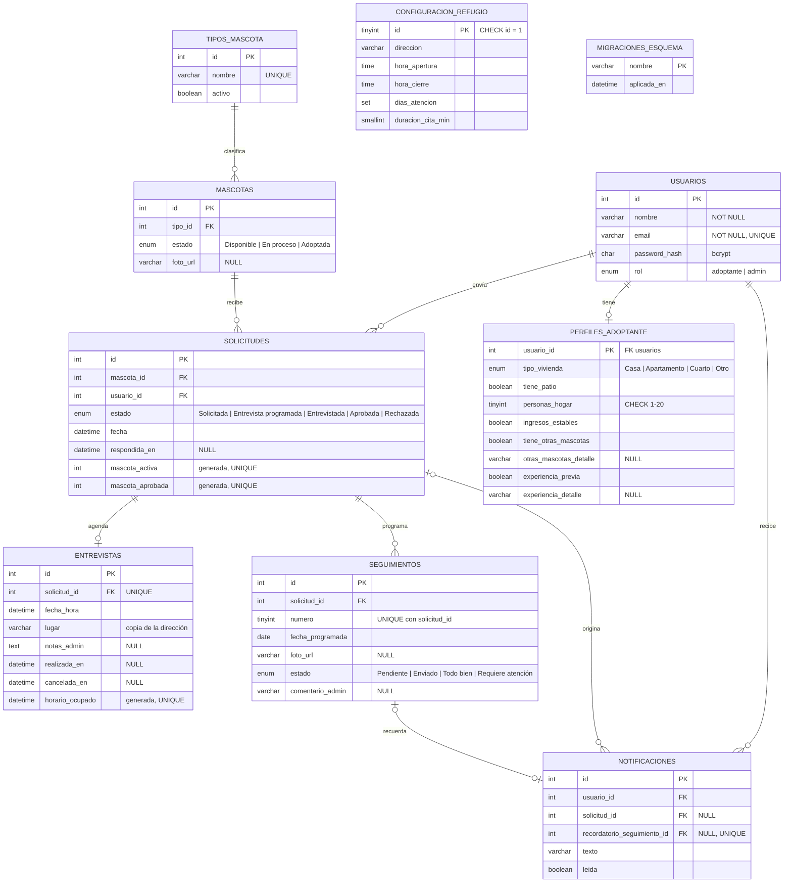

# 5. Base de datos

> Motor: **MySQL 8.0** (servicio local `MySQL80`). Todo se probó con MySQL 8.0. El script usa columnas generadas, `CHECK` con `REGEXP` y `utf8mb4`, disponibles también en MariaDB 10.4+ (la de XAMPP), pero **no se probó con XAMPP/MariaDB**.
> Scripts: [`database/01_schema.sql`](../database/01_schema.sql) (esquema base del II Parcial), [`database/migraciones/`](../database/migraciones/) (001 a 004, III Parcial) y [`database/02_seed.sql`](../database/02_seed.sql) (generado por [`database/generar-seed.js`](../database/generar-seed.js)).

## 5.1 Por qué un modelo relacional (cambio respecto al Hito 1)

El Hito 1 proponía MongoDB. Se cambió a MySQL porque el dominio es claramente relacional: una **solicitud** siempre une a un **usuario** con una **mascota**, y una **notificación** pertenece a un usuario y se refiere a una solicitud. Las reglas más importantes del negocio ("no se puede solicitar una mascota que no está disponible", "al aprobar, la mascota queda adoptada y se notifica") necesitan **integridad referencial** y **transacciones**, que un motor relacional garantiza directamente con `FOREIGN KEY`, `UNIQUE`, `CHECK` y `START TRANSACTION / COMMIT / ROLLBACK`.

## 5.2 Diagrama entidad-relación

Esquema final de `v1.0.0`: el esquema base del II Parcial (`01_schema.sql`) más las migraciones 001 a 004 (§5.13).



**Cardinalidades**
- Un usuario tiene **0 o 1** perfil de adoptante (1:1 por clave primaria compartida).
- Un usuario envía **0..N** solicitudes; cada solicitud pertenece a **exactamente 1** usuario y **1** mascota.
- Una mascota puede tener muchas solicitudes en su historial, pero **solo una activa** (Solicitada, Entrevista programada o Entrevistada) y **solo una aprobada**.
- Una solicitud tiene **0 o 1** entrevista y **0..N** controles de seguimiento (N = `SEGUIMIENTO_CANTIDAD`, 4 por defecto, creados al aprobar).
- Un control genera **0 o 1** recordatorio (notificación); una notificación se refiere a **0 o 1** solicitud.
- `configuracion_refugio` tiene **una sola fila** (un solo refugio).

## 5.3 Restricciones

| Restricción | Dónde | Para qué |
|---|---|---|
| **PRIMARY KEY** `AUTO_INCREMENT` | `id` de todas las tablas | Identificador único generado por el motor |
| **UNIQUE** | `usuarios.email` | Impide dos cuentas con el mismo correo (el backend además lo normaliza a minúsculas y responde 409) |
| **UNIQUE** | `tipos_mascota.nombre` | Impide tipos repetidos; con la intercalación `utf8mb4_unicode_ci`, "perro", "Perro" y "PERRO" se consideran el mismo |
| **UNIQUE** sobre columna generada | `solicitudes.mascota_activa` | Solo puede existir **una solicitud activa por mascota** (Solicitada, Entrevista programada o Entrevistada), incluso si dos peticiones llegan al mismo tiempo |
| **UNIQUE** sobre columna generada | `solicitudes.mascota_aprobada` | Una mascota no puede quedar aprobada para dos personas |
| **UNIQUE** | `entrevistas.solicitud_id` | Una entrevista por solicitud (reprogramar actualiza la misma fila) |
| **UNIQUE** sobre columna generada | `entrevistas.horario_ocupado` (= `fecha_hora` si no está cancelada) | Dos entrevistas no pueden ocupar el mismo horario; si un rechazo cancela una entrevista no realizada, el horario se libera |
| **UNIQUE** | `seguimientos (solicitud_id, numero)` | No se repite el número de control de una adopción |
| **UNIQUE** | `notificaciones.recordatorio_seguimiento_id` | Un solo recordatorio por control, aunque se pidan a la vez (RF-15) |
| **CHECK** | `perfiles_adoptante.personas_hogar BETWEEN 1 AND 20`; detalle obligatorio si `tiene_otras_mascotas` o `experiencia_previa` | Reglas del perfil también en la BD |
| **CHECK** | `seguimientos`: foto obligatoria salvo en *Pendiente*; comentario de 3+ caracteres en *Todo bien* / *Requiere atención*; `numero` 1–24 | Estados coherentes |
| **CHECK** | `configuracion_refugio`: `id = 1`, apertura < cierre, duración 15–240 min, dirección de 5+ caracteres | Una fila válida |
| **NOT NULL** | Todos los campos obligatorios | El motor rechaza registros incompletos |
| **CHECK** | `solicitudes.telefono REGEXP '^[0-9]{4}-[0-9]{4}$'` | El formato del teléfono también se valida en la base de datos |
| **CHECK** | Longitud mínima de `nombre`, `direccion` (5) y `motivo` (10); formato básico de `email` | Última línea de defensa si la validación del backend fallara |
| **ENUM / SET** | `rol`, `sexo`, `mascotas.estado`, `solicitudes.estado`, `seguimientos.estado`, `perfiles_adoptante.tipo_vivienda`, `configuracion_refugio.dias_atencion` | Solo se aceptan los valores del flujo definido |
| **FOREIGN KEY** | `mascotas.tipo_id`, `solicitudes.mascota_id`, `solicitudes.usuario_id`, `perfiles_adoptante.usuario_id`, `entrevistas.solicitud_id`, `seguimientos.solicitud_id`, `notificaciones.usuario_id`, `notificaciones.solicitud_id`, `notificaciones.recordatorio_seguimiento_id` | Integridad referencial: no hay registros huérfanos |

Las columnas generadas (`mascota_activa`, `mascota_aprobada`, `horario_ocupado`) valen el id de la mascota solo cuando la solicitud está en ese estado, y `NULL` en los demás casos. Como `UNIQUE` permite varios `NULL`, el historial puede tener muchas solicitudes rechazadas de la misma mascota, pero nunca dos activas.

## 5.4 Acciones referenciales (`ON DELETE` / `ON UPDATE`)

| Relación | ON DELETE | ON UPDATE | Justificación |
|---|---|---|---|
| `mascotas.tipo_id → tipos_mascota` | **RESTRICT** | CASCADE | No se puede borrar un tipo que tiene mascotas; el administrador lo **desactiva** (`activo = 0`) en lugar de borrarlo |
| `solicitudes.mascota_id → mascotas` | **RESTRICT** | RESTRICT | El historial de adopciones es evidencia del refugio: no se puede borrar una mascota con solicitudes |
| `solicitudes.usuario_id → usuarios` | **RESTRICT** | RESTRICT | No se pierde el historial de un adoptante. `ON UPDATE RESTRICT` es obligatorio aquí porque MySQL no permite `CASCADE` en columnas base de una columna generada almacenada, y los ids `AUTO_INCREMENT` nunca cambian |
| `notificaciones.usuario_id → usuarios` | **CASCADE** | CASCADE | Las notificaciones solo tienen sentido para su dueño; si se elimina la cuenta, se eliminan con ella |
| `notificaciones.solicitud_id → solicitudes` | **SET NULL** | CASCADE | La notificación se conserva como mensaje aunque la solicitud deje de existir |
| `perfiles_adoptante.usuario_id → usuarios` | **CASCADE** | CASCADE | El perfil solo existe junto a su usuario |
| `entrevistas.solicitud_id → solicitudes` | **RESTRICT** | RESTRICT | La entrevista es parte del expediente de la adopción |
| `seguimientos.solicitud_id → solicitudes` | **RESTRICT** | RESTRICT | Los controles son evidencia del seguimiento post-adopción |
| `notificaciones.recordatorio_seguimiento_id → seguimientos` | **CASCADE** | CASCADE | El recordatorio no tiene sentido sin su control |

## 5.5 Índices

| Índice | Consulta que acelera |
|---|---|
| `ix_mascotas_estado_tipo (estado, tipo_id)` | Catálogo filtrado por estado y tipo (RF-03) |
| `ix_mascotas_nombre (nombre)` | Búsqueda por nombre |
| `ix_solicitudes_usuario (usuario_id, fecha)` | Historial propio ordenado por fecha (RF-10) |
| `ix_solicitudes_estado (estado)` | Solicitudes pendientes del panel (RF-08) |
| `ix_notificaciones_usuario_leida (usuario_id, leida, creado_en)` | Lista de notificaciones y contador de no leídas (RF-07) |
| `ix_entrevistas_fecha (fecha_hora)` y `uq_entrevistas_horario` | Disponibilidad de un día y agenda semanal (RF-12) |
| `ix_seguimientos_estado_fecha (estado, fecha_programada)` | Controles por revisar y controles vencidos para los recordatorios (RF-14, RF-15) |

## 5.6 Datos semilla

Se generan con `npm run db:seed`, que lee [`database/datos-semilla.js`](../database/datos-semilla.js) (fuente única) y escribe `02_seed.sql`. Hay dos mecanismos para que el seed no tenga secretos ni fechas fijas:
- **Contraseñas por variable de entorno:** el seed solo tiene marcadores (`@@SEED_ADMIN_PASSWORD@@`, `@@SEED_ADOPTANTE_PASSWORD@@`, `@@SEED_ADOPTANTE2_PASSWORD@@`). `npm run db:instalar` calcula el hash bcrypt (10 rondas) con los valores del `.env` y rechaza los valores `EJEMPLO_...` de `.env.example` (DEF-22).
- **Fechas relativas:** las fechas son expresiones SQL (`TIMESTAMP(CURDATE() - INTERVAL 45 DAY, '09:30:00')`), así que la historia siempre es coherente con el día de la instalación. La entrevista de Mechudo siempre queda 3 días después de la instalación (o 4, si ese día cae domingo) a las 10:30 a. m.

Todos los datos de personas son **ficticios**.

| Tabla | Registros |
|---|---|
| `tipos_mascota` | 9: Perro, Gato, Ave, Conejo, Cuyo, Hámster, Pez, Tortuga, Otro |
| `usuarios` | 3: Administrador Refugio (`admin@patitas.com`), Edwin Obando (`edwin.obando@correo.com`) y Ana Martínez (`ana.martinez@correo.com`) |
| `perfiles_adoptante` | 2: Edwin (apartamento sin patio, 2 personas, una gata, experiencia con loras) y Ana (casa con patio, 4 personas) |
| `mascotas` | 10 reales del refugio: 6 Disponibles, 2 En proceso (Mechudo y Vaquita), 2 Adoptadas (Encantador y Lara) |
| `solicitudes` | 5: Mechudo *Entrevista programada*; Encantador y Lara *Aprobadas*; Princesa Sucia *Rechazada* después de la entrevista (todas de Edwin); Vaquita *Solicitada* (de Ana, para que el admin tenga una cita por agendar) |
| `entrevistas` | 4: la de Mechudo (futura) y tres realizadas con fechas pasadas coherentes; la de Princesa Sucia tiene en las notas del admin el motivo del rechazo |
| `seguimientos` | 8: Lara con el control 1 *Todo bien* (foto y comentario) y el control 2 **vencido y pendiente**, que genera el recordatorio; los controles 3 y 4 de Lara y los 4 de Encantador, futuros |
| `notificaciones` | 11 coherentes con lo anterior (recibida, agendada, aprobada, rechazada, revisión del control 1), incluido un aviso de nueva mascota; al iniciar sesión Edwin se genera además el recordatorio del control 2 de Lara |
| `configuracion_refugio` | La crea la migración 003: "Refugio Patitas Conectadas", Barrio Las Flores, lunes a sábado de 09:00 a 16:00, citas de 30 minutos |

Los estados son coherentes: toda mascota *Adoptada* tiene su solicitud *Aprobada* con entrevista realizada, y toda mascota *En proceso* tiene una solicitud activa.

## 5.7 Usuario de base de datos con mínimo privilegio

La aplicación **no usa `root`**. Se conecta con el usuario `patitas_app`, que solo puede trabajar sobre las dos bases de datos del proyecto:

```sql
CREATE USER 'patitas_app'@'localhost' IDENTIFIED BY '<contraseña segura>';
GRANT ALL PRIVILEGES ON patitas_conectadas.* TO 'patitas_app'@'localhost';
GRANT ALL PRIVILEGES ON patitas_test.*       TO 'patitas_app'@'localhost';
GRANT PROCESS ON *.* TO 'patitas_app'@'localhost';
FLUSH PRIVILEGES;
```

- Si la aplicación se viera comprometida, el atacante no podría leer ni modificar otras bases de datos del servidor, ni crear usuarios.
- `PROCESS` es el único privilegio global, y lo necesita `mysqldump` para el respaldo previo a la migración. Además, `mysqldump` se ejecuta con `--no-tablespaces`, para no requerir privilegios adicionales.
- Las credenciales viven solo en `.env` (excluido de Git). En el repositorio solo está `.env.example` con `DB_USER=patitas_app` y la contraseña vacía.

## 5.8 Transacciones implementadas

Todas usan `enTransaccion` de [`src/config/db.js`](../src/config/db.js) (`beginTransaction` → trabajo → `commit`, o `rollback` ante cualquier error) y bloquean con `SELECT ... FOR UPDATE` las filas que van a cambiar. Los repositorios reciben la conexión de la transacción.

| Operación | Endpoint | Pasos dentro de la transacción | Si algo falla |
|---|---|---|---|
| Crear solicitud (RF-06) | `POST /api/solicitudes` | Perfil del adoptante → mascota `FOR UPDATE` (debe estar Disponible) → sin otra solicitud activa → `INSERT` solicitud *Solicitada* → mascota *En proceso* → notificación "Recibimos tu solicitud" | 400 sin perfil; 409 si no está disponible (también por el UNIQUE `mascota_activa`); rollback |
| Agendar o reprogramar entrevista (RF-12) | `PATCH /api/admin/solicitudes/:id/entrevista` | Solicitud `FOR UPDATE` (Solicitada o Entrevista programada) → validar horario (futuro, día y hora de atención, libre) → `INSERT` entrevista con la dirección vigente (o `UPDATE` si se reprograma) → estado *Entrevista programada* → notificación con día y hora en texto | 400 por horario inválido; 409 si está ocupado (también por el UNIQUE `horario_ocupado`) o si la etapa no corresponde |
| Marcar entrevistada (RF-12) | `PATCH .../entrevistada` | Solicitud `FOR UPDATE` (Entrevista programada) → `realizada_en = NOW()` y notas → estado *Entrevistada* | 409 en otra etapa |
| Aprobar (RF-08, RF-13) | `PATCH .../estado` `{estado:"Aprobada"}` | Solicitud y mascota `FOR UPDATE` → debe estar *Entrevistada* → solicitud *Aprobada* (`respondida_en`) → mascota *Adoptada* → **N controles** cada X días → notificación | 409 sin entrevista; si falla la creación de los controles o la notificación, **rollback total** (PR-19, PR-46) |
| Rechazar (RF-08) | `PATCH .../estado` `{estado:"Rechazada", motivo}` | Solicitud y mascota `FOR UPDATE` → debe estar activa → *Rechazada* → mascota *Disponible* → entrevista no realizada `cancelada_en` (libera el horario) y motivo en `notas_admin` → notificación | 409 si ya fue respondida |
| Enviar foto de un control (RF-13) | `POST /api/seguimientos/:id/foto` | Control `FOR UPDATE` → el dueño es el usuario → *Pendiente* y con fecha ya cumplida → `foto_url`, `enviado_en`, *Enviado* | 403 ajeno, 409 futuro o ya enviado; el archivo subido se borra |
| Revisar control (RF-14) | `PATCH /api/admin/seguimientos/:id` | Control `FOR UPDATE` → *Enviado* → estado y comentario → notificación | 409 en otro estado |

Los **recordatorios** (RF-15) no necesitan una transacción explícita: es un único `INSERT IGNORE ... SELECT ... WHERE NOT EXISTS`, y el UNIQUE `recordatorio_seguimiento_id` impide duplicados si dos consultas llegan juntas.

### Verificación realizada (contra `patitas_test`)

| Caso | Prueba | Resultado (2026-11-07) |
|---|---|---|
| Dos adoptantes solicitan *El Hambriento* al mismo tiempo | PR-20 | [201, 409] y una sola fila |
| Aprobar con un fallo forzado en la notificación | PR-19 | 500; la base queda idéntica |
| Aprobar con un fallo forzado al crear los controles | PR-46 | 500; sigue *Entrevistada*, mascota *En proceso*, 0 controles, mismas notificaciones |
| Dos agendas simultáneas en el mismo horario | PR-39 | [200, 409] |
| Aprobar sin entrevista | PR-40 | 409 y sin cambios |
| Recordatorio pedido 3 veces en paralelo + script | PR-50 | 1 solo recordatorio |

## 5.9 Manejo de duplicados e inválidos

| Situación | Capa que lo detecta | Respuesta |
|---|---|---|
| Correo ya registrado | Servicio (consulta previa) y BD (`UNIQUE email`) | 409 "Ya existe una cuenta con ese correo." |
| Tipo de mascota repetido | BD (`UNIQUE nombre`), traducido por el servicio | 409 "Ya existe un tipo de mascota con ese nombre." |
| Segunda solicitud activa para la misma mascota | Servicio y BD (`UNIQUE mascota_activa`) | 409 |
| Horario de entrevista ocupado | Servicio y BD (`UNIQUE horario_ocupado`) | 409 "Ese horario ya está ocupado. Elige otro." |
| Perfil incompleto o fuera de rango | Servidor y BD (`CHECK`) | 400 con el detalle |
| Teléfono con otro formato | Navegador, servidor y BD (`CHECK`) | 400 "El teléfono debe tener el formato 8888-1234." |
| Campos vacíos o demasiado largos | Servidor (validadores) y BD (`NOT NULL`, `CHECK`, longitudes) | 400 con el detalle de cada campo |
| Mascota, tipo o solicitud inexistente | Servicio | 404 |
| Cualquier otro error de MySQL | Middleware central de errores | Código coherente (400/409) o 500 genérico, nunca el detalle interno |

## 5.10 Fotos de las mascotas

- La base de datos guarda solo la **ruta pública** de la foto en `mascotas.foto_url` (por ejemplo `/uploads/mascotas/mechudo.jpg`), nunca el archivo. `NULL` significa "sin foto", y la interfaz muestra una huella SVG. Las fotos de los controles post-adopción usan la misma carpeta y las mismas validaciones (`seguimientos.foto_url`).
- Los archivos viven en `uploads/mascotas/` (excluida de Git) y Express los sirve como estáticos en `/uploads`. Las pruebas usan `uploads-pruebas/` para no tocar las fotos reales.
- Las fotos de los datos semilla están versionadas en [`database/seed-fotos/`](../database/seed-fotos/); `npm run db:instalar` las copia a `uploads/mascotas/`. Antes de incluirlas se verificó que ninguna tuviera metadatos EXIF (ubicación GPS).
- Las subidas nuevas reciben un nombre aleatorio (UUID). Se aceptan solo JPG, PNG o WEBP de hasta 2 MB, y se comprueba la firma binaria del archivo, no solo el tipo declarado por el navegador.
- Si una petición falla después de subir la foto (datos inválidos, tipo inexistente, regla de estado), el archivo se borra antes de responder. Al reemplazar o quitar una foto, la anterior se borra solo después de confirmar la transacción.

## 5.11 Operaciones de inserción, consulta y actualización

Todas las operaciones están en los repositorios de cada módulo y usan **consultas parametrizadas** (`?`): los valores viajan separados del SQL, lo que impide la inyección SQL.

### Insertar — registrar un adoptante ([`usuarios/repositorio.js`](../src/modules/usuarios/repositorio.js))

```sql
INSERT INTO usuarios (nombre, email, password_hash, rol) VALUES (?, ?, ?, ?);
-- valores: 'Ana López', 'ana@correo.com', '$2b$10$…(hash bcrypt)…', 'adoptante'
```

```js
const [resultado] = await pool.execute(
  "INSERT INTO usuarios (nombre, email, password_hash, rol) VALUES (?, ?, ?, ?)",
  [nombre, email, passwordHash, rol]
);
return resultado.insertId;
```

### Consultar — catálogo filtrado ([`mascotas/repositorio.js`](../src/modules/mascotas/repositorio.js))

```sql
SELECT m.id, m.nombre, m.edad, m.raza, m.sexo, m.descripcion, m.estado, m.foto_url AS fotoUrl,
       t.id AS tipoId, t.nombre AS tipoNombre, t.icono AS tipoIcono
FROM mascotas m
INNER JOIN tipos_mascota t ON t.id = m.tipo_id
WHERE m.tipo_id = ? AND m.estado IN (?, ?) AND m.nombre LIKE ?
ORDER BY FIELD(m.estado, 'Disponible', 'En proceso', 'Adoptada'), m.nombre;
-- valores: 2, 'Disponible', 'En proceso', '%calen%'
```

Otras consultas representativas:

| Consulta | SQL (resumido) | Uso |
|---|---|---|
| Historial propio | `SELECT … FROM solicitudes s JOIN mascotas m … WHERE s.usuario_id = ? ORDER BY s.fecha DESC` | RF-10 |
| Contador de no leídas | `SELECT COUNT(*) FROM notificaciones WHERE usuario_id = ? AND leida = 0` | RF-07 |
| Estadísticas del inicio | `SELECT estado, COUNT(*) FROM mascotas GROUP BY estado` | Página de inicio |
| Filtros del catálogo | `SELECT t.…, COUNT(m.id) FROM tipos_mascota t LEFT JOIN mascotas m ON m.tipo_id = t.id AND m.estado IN (…) WHERE t.activo = 1 GROUP BY t.id HAVING COUNT(m.id) > 0` | RF-03 |

### Actualizar — editar una mascota ([`mascotas/repositorio.js`](../src/modules/mascotas/repositorio.js))

```sql
UPDATE mascotas
SET nombre = ?, tipo_id = ?, edad = ?, raza = ?, sexo = ?, descripcion = ?, estado = ?, foto_url = ?
WHERE id = ?;
```

Se ejecuta dentro de una transacción, después de `SELECT … FROM mascotas WHERE id = ? FOR UPDATE`, para verificar las reglas de estado (por ejemplo, que la mascota no tenga una solicitud activa). Otros ejemplos de actualización:

| Operación | SQL | Uso |
|---|---|---|
| Marcar notificación como leída | `UPDATE notificaciones SET leida = 1 WHERE id = ?` | RF-07 |
| Responder solicitud | `UPDATE solicitudes SET estado = ? WHERE id = ?` (dentro de la transacción de §5.8) | RF-08 |
| Desactivar un tipo | `UPDATE tipos_mascota SET nombre = ?, icono = ?, activo = COALESCE(?, activo) WHERE id = ?` | RF-09 |

No hay borrados físicos en la aplicación: los tipos se **desactivan** y las mascotas con historial no pueden eliminarse (`ON DELETE RESTRICT`), para conservar la trazabilidad de las adopciones.

## 5.12 Diccionario de datos

Tipos de MySQL 8.0. *PK* clave primaria · *FK* clave foránea · *UQ* único · *Gen.* columna generada almacenada.

### `usuarios`
| Columna | Tipo | Nulo | Clave / regla | Descripción |
|---|---|---|---|---|
| id | INT UNSIGNED AUTO_INCREMENT | No | PK | Identificador |
| nombre | VARCHAR(100) | No | CHECK ≥ 2 caracteres | Nombre visible |
| email | VARCHAR(150) | No | UQ; CHECK de formato | Correo en minúsculas |
| password_hash | CHAR(60) | No | — | Hash bcrypt |
| rol | ENUM('adoptante','admin') | No | DEFAULT 'adoptante' | Rol |
| creado_en | DATETIME | No | DEFAULT NOW | Alta |

### `perfiles_adoptante` (migración 002)
| Columna | Tipo | Nulo | Clave / regla | Descripción |
|---|---|---|---|---|
| usuario_id | INT UNSIGNED | No | PK, FK usuarios (CASCADE) | Dueño del perfil (1:1) |
| tipo_vivienda | ENUM('Casa','Apartamento','Cuarto','Otro') | No | — | Tipo de vivienda |
| tiene_patio | BOOLEAN | No | — | Tiene patio |
| personas_hogar | TINYINT UNSIGNED | No | CHECK 1–20 | Personas que viven en el hogar |
| ingresos_estables | BOOLEAN | No | — | Ingresos estables |
| tiene_otras_mascotas | BOOLEAN | No | — | Tiene otras mascotas |
| otras_mascotas_detalle | VARCHAR(200) | Sí | CHECK obligatorio (≥ 3) si tiene_otras_mascotas | Cuáles |
| experiencia_previa | BOOLEAN | No | — | Experiencia cuidando mascotas |
| experiencia_detalle | VARCHAR(300) | Sí | CHECK obligatorio (≥ 3) si experiencia_previa | Cuál |
| actualizado_en | DATETIME | No | ON UPDATE NOW | Última edición |

### `tipos_mascota`
| Columna | Tipo | Nulo | Clave / regla | Descripción |
|---|---|---|---|---|
| id | INT UNSIGNED AUTO_INCREMENT | No | PK | Identificador |
| nombre | VARCHAR(40) | No | UQ; CHECK ≥ 2 | Perro, Gato, ... |
| activo | BOOLEAN | No | DEFAULT 1 | Se desactiva en lugar de borrarse |
| creado_en | DATETIME | No | DEFAULT NOW | Alta |

La columna `icono` se eliminó en la migración 001 (interfaz sin emojis).

### `mascotas`
| Columna | Tipo | Nulo | Clave / regla | Descripción |
|---|---|---|---|---|
| id | INT UNSIGNED AUTO_INCREMENT | No | PK | Identificador |
| nombre | VARCHAR(60) | No | CHECK ≥ 1 | Nombre |
| tipo_id | INT UNSIGNED | No | FK tipos_mascota (RESTRICT) | Tipo |
| edad | VARCHAR(30) | No | — | Edad en texto ("4 meses") |
| raza | VARCHAR(80) | No | — | Raza |
| sexo | ENUM('Macho','Hembra') | No | — | Sexo |
| descripcion | TEXT | No | — | Descripción |
| estado | ENUM('Disponible','En proceso','Adoptada') | No | DEFAULT 'Disponible' | "En proceso" solo lo asigna una solicitud |
| foto_url | VARCHAR(255) | Sí | — | `/uploads/mascotas/<archivo>` |
| creado_en, actualizado_en | DATETIME | No | — | Auditoría |

### `solicitudes`
| Columna | Tipo | Nulo | Clave / regla | Descripción |
|---|---|---|---|---|
| id | INT UNSIGNED AUTO_INCREMENT | No | PK | Identificador |
| mascota_id | INT UNSIGNED | No | FK mascotas (RESTRICT) | Mascota solicitada |
| usuario_id | INT UNSIGNED | No | FK usuarios (RESTRICT) | Adoptante |
| telefono | CHAR(9) | No | CHECK `^[0-9]{4}-[0-9]{4}$` | Teléfono de contacto |
| direccion | VARCHAR(200) | No | CHECK ≥ 5 | Dirección del adoptante |
| motivo | VARCHAR(1000) | No | CHECK ≥ 10 | Motivo |
| estado | ENUM('Solicitada','Entrevista programada','Entrevistada','Aprobada','Rechazada') | No | DEFAULT 'Solicitada' | Etapa (migración 003; antes "En revisión") |
| fecha | DATETIME | No | DEFAULT NOW | Fecha de la solicitud |
| respondida_en | DATETIME | Sí | — | Fecha de aprobación o rechazo (migración 003) |
| actualizado_en | DATETIME | No | ON UPDATE NOW | Último cambio |
| mascota_activa | INT UNSIGNED | Sí | Gen.; UQ | mascota_id si la etapa es activa |
| mascota_aprobada | INT UNSIGNED | Sí | Gen.; UQ | mascota_id si está Aprobada |

### `entrevistas` (migración 003)
| Columna | Tipo | Nulo | Clave / regla | Descripción |
|---|---|---|---|---|
| id | INT UNSIGNED AUTO_INCREMENT | No | PK | Identificador |
| solicitud_id | INT UNSIGNED | No | FK solicitudes (RESTRICT); UQ | Solicitud |
| fecha_hora | DATETIME | No | Futura al agendar (validado en el servicio) | Día y hora de la cita |
| lugar | VARCHAR(255) | No | CHECK ≥ 5 | Copia de la dirección del refugio al agendar |
| notas_admin | TEXT | Sí | — | Notas internas (no se muestran al adoptante) |
| realizada_en | DATETIME | Sí | — | Cuándo se marcó como realizada |
| cancelada_en | DATETIME | Sí | — | Cuándo se canceló por rechazo |
| creado_en, actualizado_en | DATETIME | No | — | Auditoría (creado_en = fecha de la etapa "Entrevista programada") |
| horario_ocupado | DATETIME | Sí | Gen.; UQ | fecha_hora si no está cancelada |

### `seguimientos` (migración 004)
| Columna | Tipo | Nulo | Clave / regla | Descripción |
|---|---|---|---|---|
| id | INT UNSIGNED AUTO_INCREMENT | No | PK | Identificador |
| solicitud_id | INT UNSIGNED | No | FK solicitudes (RESTRICT) | Adopción |
| numero | TINYINT UNSIGNED | No | UQ con solicitud_id; CHECK 1–24 | Número de control |
| fecha_programada | DATE | No | — | Fecha desde la que se puede subir la foto |
| foto_url | VARCHAR(255) | Sí | CHECK obligatoria salvo en Pendiente | Foto enviada |
| enviado_en | DATETIME | Sí | — | Cuándo se envió |
| estado | ENUM('Pendiente','Enviado','Todo bien','Requiere atención') | No | DEFAULT 'Pendiente' | Estado del control |
| comentario_admin | VARCHAR(500) | Sí | CHECK ≥ 3 al revisar | Comentario del refugio |
| revisado_en | DATETIME | Sí | — | Cuándo se revisó |

### `notificaciones`
| Columna | Tipo | Nulo | Clave / regla | Descripción |
|---|---|---|---|---|
| id | INT UNSIGNED AUTO_INCREMENT | No | PK | Identificador |
| usuario_id | INT UNSIGNED | No | FK usuarios (CASCADE) | Destinatario |
| solicitud_id | INT UNSIGNED | Sí | FK solicitudes (SET NULL) | Solicitud relacionada (enlace al seguimiento) |
| texto | VARCHAR(255) | No | — | Mensaje |
| leida | BOOLEAN | No | DEFAULT 0 | Leída |
| creado_en | DATETIME | No | DEFAULT NOW | Fecha |
| recordatorio_seguimiento_id | INT UNSIGNED | Sí | FK seguimientos (CASCADE); UQ | Control recordado (migración 004) |

### `configuracion_refugio` (migración 003)
| Columna | Tipo | Nulo | Clave / regla | Descripción |
|---|---|---|---|---|
| id | TINYINT UNSIGNED | No | PK; CHECK id = 1 | Fila única |
| nombre | VARCHAR(100) | No | — | Nombre del refugio |
| direccion | VARCHAR(255) | No | CHECK ≥ 5 | Lugar de las entrevistas |
| telefono | VARCHAR(20) | No | — | Teléfono |
| hora_apertura, hora_cierre | TIME | No | CHECK apertura < cierre | Horario de atención |
| dias_atencion | SET('lunes',...,'domingo') | No | — | Días de atención (lunes a sábado) |
| duracion_cita_min | SMALLINT UNSIGNED | No | CHECK 15–240; DEFAULT 30 | Duración de cada turno |
| actualizado_en | DATETIME | No | ON UPDATE NOW | Última edición |

### `migraciones_esquema`
| Columna | Tipo | Nulo | Clave / regla | Descripción |
|---|---|---|---|---|
| nombre | VARCHAR(100) | No | PK | Archivo aplicado (`003_entrevistas.sql`) |
| aplicada_en | DATETIME | No | DEFAULT NOW | Cuándo se aplicó |

## 5.13 Migraciones del esquema

El esquema evoluciona con archivos numerados en [`database/migraciones/`](../database/migraciones/), que se registran en `migraciones_esquema`:

| Archivo | Qué hace |
|---|---|
| `001_quitar_icono_tipos.sql` | Elimina `tipos_mascota.icono` (interfaz sin emojis) |
| `002_perfiles_adoptante.sql` | Crea `perfiles_adoptante` |
| `003_entrevistas.sql` | Etapas nuevas de la solicitud ("En revisión" → "Solicitada" en los datos existentes), `respondida_en`, UNIQUE de solicitud activa, `configuracion_refugio` con su fila y `entrevistas` |
| `004_seguimientos.sql` | Crea `seguimientos` y `notificaciones.recordatorio_seguimiento_id` |

- `npm run db:instalar` borra las tablas, aplica `01_schema.sql`, **todas** las migraciones y el seed. Así cada prueba ejercita las migraciones.
- `npm run db:migrar` aplica solo las pendientes a una base existente **sin borrar datos** (PR-33 verifica que una base al día no cambia).
- MySQL no hace `ROLLBACK` de DDL, así que antes de migrar una base con datos reales hay que respaldarla (doc 18).
