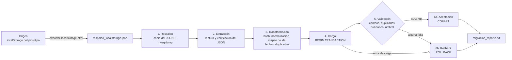

# 8. Migración de datos

La fuente anterior real del sistema es el **localStorage del navegador** donde funcionaba el prototipo del Hito 1. Allí vivían los usuarios (con contraseñas en texto plano), las mascotas, las solicitudes y las notificaciones. La migración lleva esos datos a MySQL sin perder relaciones y sin poner en riesgo la base de datos de destino.

## 8.1 Resumen

| Fuente | Destino | Respaldo | Transformación | Entorno seguro | Validación | Rollback |
|---|---|---|---|---|---|---|
| localStorage del prototipo (`pc_users`, `pc_pets`, `pc_requests`, `pc_notifications`) exportado a `respaldo_localstorage.json` con [`exportar-localstorage.html`](../database/migracion/exportar-localstorage.html) | Base de datos MySQL `patitas_test` (pruebas) y, solo después, `patitas_conectadas` (producción) | Antes de tocar nada: copia fechada del JSON y volcado `mysqldump --no-tablespaces` de la base de destino en `database/migracion/respaldos/<fecha>/` | Hash bcrypt de contraseñas, correos en minúsculas, ids `Date.now()` mapeados a ids nuevos conservando relaciones, tipo de texto → `tipos_mascota`, fechas relativas ("Hace 2 horas", "Ayer") → `DATETIME`, teléfonos normalizados, duplicados unificados o descartados | Se ejecuta por defecto contra `patitas_test`; producción exige `--confirmar-produccion`; cualquier otra base es rechazada | Conteos origen = insertados + vinculados + descartados, registros presentes en el destino, sin correos duplicados, sin solicitudes ni notificaciones huérfanas, umbral opcional de descartes | Toda la carga ocurre en **una transacción**: si falla un paso o una validación se hace `ROLLBACK` y el destino queda exactamente igual |

## 8.2 Flujo



## 8.3 Archivos

| Archivo | Función |
|---|---|
| [`database/migracion/exportar-localstorage.html`](../database/migracion/exportar-localstorage.html) | Página independiente que lee las cuatro claves del localStorage y descarga `respaldo_localstorage.json` |
| [`database/migracion/migrar.js`](../database/migracion/migrar.js) | Script ETL: respaldo → extracción → transformación → carga → validación → aceptación o rollback → reporte |
| [`database/migracion/transformar.js`](../database/migracion/transformar.js) | Funciones de transformación (correo, teléfono, estados, fechas relativas), probadas con Jest |
| [`database/migracion/respaldo_localstorage.ejemplo.json`](../database/migracion/respaldo_localstorage.ejemplo.json) | Respaldo de ejemplo: los datos del prototipo más casos sucios para demostrar cada regla |
| `database/migracion/respaldos/` y `migracion_reporte.txt` | Salidas de cada ejecución. **Excluidas de Git**, porque el JSON de origen contiene contraseñas en texto plano |

## 8.4 Reglas de transformación

| Dato de origen | Regla | Si no se puede transformar |
|---|---|---|
| Contraseña en texto plano | Se guarda como hash bcrypt (10 rondas); si tiene menos de 8 caracteres se agrega un aviso para pedir que la cambie | Sin contraseña → se descarta el usuario |
| Correo | `trim` + minúsculas + validación de formato | Formato inválido → se descarta el usuario |
| Correo repetido en el origen | Se unifica con la primera cuenta (sus solicitudes quedan con esa cuenta) | — |
| Correo que ya existe en el destino | Se **vincula** a la cuenta existente sin modificarla (por ejemplo, el administrador) | — |
| Ids tipo `Date.now()` | Mapas id de origen → id nuevo (`AUTO_INCREMENT`) que conservan las relaciones | — |
| Tipo de mascota (texto) | Se busca en `tipos_mascota` sin distinguir mayúsculas ni acentos | Tipo desconocido → "Otro" y aviso |
| Mascota que ya existe (mismo nombre y tipo) | Se vincula, no se duplica | — |
| Teléfono | Se dejan solo los dígitos (y se quita el prefijo 505) → formato `8888-1234` | No quedan 8 dígitos → se descarta la solicitud |
| Solicitud sin usuario o sin mascota | — | Se descarta como **huérfana** |
| Solicitud que rompe las reglas (segunda *En revisión* o *Aprobada* de la misma mascota, o duplicada) | — | Se descarta |
| Fecha `YYYY-MM-DD` | `DATETIME` a las 00:00 | — |
| Fecha relativa ("Hace un momento", "Hace N minutos/horas/días", "Ayer") | Se calcula a partir de la fecha de exportación del respaldo (`exportadoEn`) | Texto ilegible → fecha de exportación y aviso |
| Notificaciones | Se cargan como leídas (el prototipo no guardaba ese estado) y sin solicitud asociada (el prototipo no tenía ese vínculo) | Usuario inexistente → se descarta |

## 8.5 Resultado real de la migración de prueba

Ejecución: `node database/migracion/migrar.js` contra `patitas_test`, recién instalada con los datos semilla. Salida completa en [`docs/evidencias/migracion.txt`](evidencias/migracion.txt).

| Entidad | Origen | Insertados | Vinculados | Descartados |
|---|---|---|---|---|
| usuarios | 5 | 2 | 2 | 1 |
| mascotas | 8 | 8 | 0 | 0 |
| solicitudes | 7 | 5 | 0 | 2 |
| notificaciones | 6 | 5 | 0 | 1 |

- **Respaldo:** copia del JSON y volcado `mysqldump` de `patitas_test` (≈12 KB), en una carpeta fechada.
- **Vinculados:** `admin@patitas.com` ya existía en el destino; `JUAN@correo.com` era un duplicado de `juan@correo.com` en el origen y se unificó.
- **Descartados:** un usuario con correo inválido, una solicitud huérfana (mascota 999), una solicitud con teléfono `88-12` y una notificación de un usuario descartado.
- **Transformaciones:** 2 contraseñas hasheadas (una con aviso por tener menos de 8 caracteres), el tipo "Hurón" asignado a "Otro", el teléfono `8765 4321` normalizado, 4 fechas relativas convertidas y 1 fecha ilegible reemplazada.
- **Validación:** 11 de 11 comprobaciones en OK. Conteos en el destino: usuarios 2 → 4, mascotas 10 → 18, solicitudes 4 → 9, notificaciones 5 → 10.
- **Decisión:** **ACEPTADA (COMMIT)**. Los usuarios migrados inician sesión con su contraseña anterior (ahora protegida con bcrypt) y las mascotas migradas aparecen en el catálogo.

### Demostración del rollback

Ejecución: `node database/migracion/migrar.js --max-descartes 0` (criterio de aceptación estricto: ningún descarte permitido). Salida completa en [`docs/evidencias/migracion_rollback.txt`](evidencias/migracion_rollback.txt).

- La validación "Descartes dentro del umbral aceptado (máximo 0)" **falla** (4 descartados).
- Decisión: **RECHAZADA (ROLLBACK)**. Los conteos del destino son idénticos antes y después: usuarios 2, mascotas 10, solicitudes 4, notificaciones 5.

### Repetir la migración

Volver a ejecutarla sobre una base ya migrada no duplica nada: los usuarios y mascotas se vinculan, y las solicitudes y notificaciones se descartan como duplicadas.

Este comportamiento también está cubierto por las pruebas automáticas PR-24 a PR-27 ([`tests/migracion.test.js`](../tests/migracion.test.js)).

## 8.6 Cómo ejecutar la migración real

1. **Exportar:** abrir `database/migracion/exportar-localstorage.html` en el **mismo navegador y de la misma forma** en que se usó el prototipo (doble clic desde el explorador si se abría así, o el mismo puerto de Live Server). El localStorage es distinto para cada origen. La página muestra cuántos registros encontró y descarga `respaldo_localstorage.json`.
2. **Copiar** el archivo a `database/migracion/`. Está excluido de Git porque contiene contraseñas en texto plano.
3. **Probar en el entorno seguro:**
   ```powershell
   npm run db:instalar:test
   npm run migrar -- --archivo database/migracion/respaldo_localstorage.json --simular
   npm run migrar -- --archivo database/migracion/respaldo_localstorage.json
   ```
   `--simular` hace todo el proceso pero siempre termina en rollback, para revisar el reporte antes de confirmar.
4. **Revisar** `database/migracion/migracion_reporte.txt`: descartes, avisos y validaciones.
5. **Producción**, solo si la prueba fue aceptada:
   ```powershell
   npm run migrar -- --archivo database/migracion/respaldo_localstorage.json --bd patitas_conectadas --confirmar-produccion
   ```
6. **Eliminar** `respaldo_localstorage.json` y las copias en `respaldos/` cuando ya no se necesiten, o guardarlas en un lugar seguro.

Opciones de `migrar.js`: `--archivo <ruta>` (por defecto, el ejemplo), `--bd <nombre>` (por defecto `patitas_test`), `--simular`, `--max-descartes <n>` y `--confirmar-produccion`.

El respaldo usa `mysqldump --no-tablespaces --single-transaction` con el usuario `patitas_app`, que tiene el privilegio `PROCESS`. La contraseña se pasa en un archivo temporal de opciones que se borra al terminar, nunca en la línea de comandos. Si el respaldo falla, la migración **no se ejecuta**.
