# 17. Manual de usuario

> Patitas Conectadas `v1.0.0`. Las capturas son reales, generadas el 2026-11-07 con `npm run capturas:manual` y `npm run test:e2e` sobre los datos semilla ficticios.
> Para abrir el sistema: http://localhost:3000 (ver la instalación en el [README](../README.md)).

---

## Parte A — Manual del adoptante

### A1. Crear tu cuenta
1. Entra a **Registrarse** en la barra superior.
2. Escribe tu nombre, tu correo y una contraseña de **8 caracteres o más**; repítela en la confirmación.
3. Pulsa **Crear cuenta**. Si el correo ya existe, el sistema te avisa.

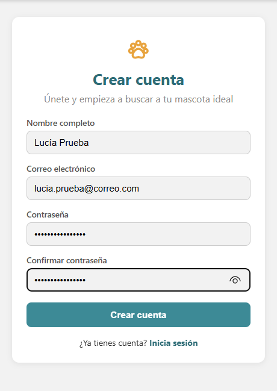

### A2. Iniciar sesión
1. Entra a **Iniciar sesión**, escribe tu correo y tu contraseña y pulsa **Ingresar**.
2. Si te equivocas, verás "Correo o contraseña incorrectos". Después de 5 intentos fallidos tendrás que esperar 15 minutos.

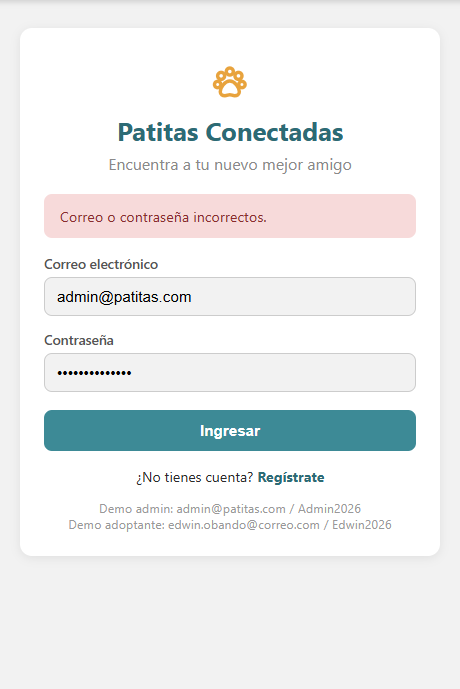

### A3. Completar tu perfil (obligatorio para solicitar)
1. En la barra, entra a **Mi perfil**.
2. Elige el tipo de vivienda, escribe cuántas personas viven contigo (1 a 20) y responde Sí o No a patio, ingresos estables, otras mascotas y experiencia.
3. Si respondes **Sí** a otras mascotas o a experiencia, aparece un campo para describirlo; es obligatorio.
4. Pulsa **Guardar perfil**. Puedes volver a editarlo cuando quieras.

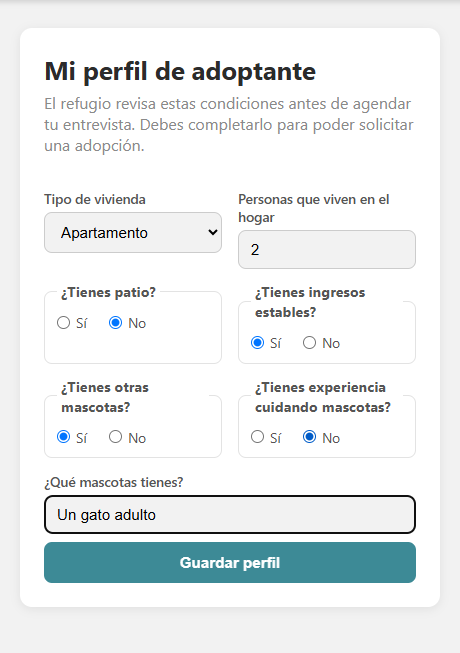

> Si intentas solicitar una mascota sin perfil, el sistema te lleva a *Mi perfil* y, al guardarlo, te devuelve a la solicitud.
> 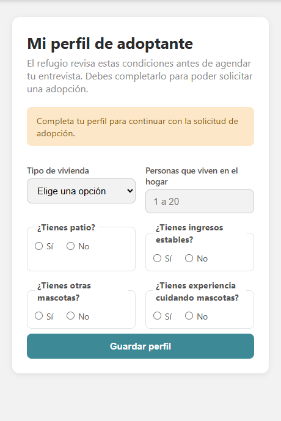

### A4. Buscar una mascota
1. Entra a **Mascotas**. Verás las mascotas *Disponibles* y, al final, las que están *En proceso*.
2. Filtra por tipo (Perro, Gato, Ave…) o escribe parte del nombre en el buscador.
3. Marca **Ver adoptadas** si quieres conocer a las mascotas que ya encontraron hogar.

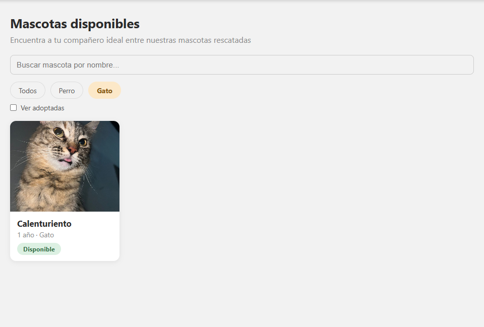

### A5. Ver la ficha y solicitar la adopción
1. Pulsa una mascota para abrir su ficha (foto, raza, edad, sexo y descripción).
2. Si está *Disponible*, pulsa **Solicitar adopción**.
3. Escribe tu teléfono con el formato **8888-1234**, tu dirección y por qué quieres adoptarla. Pulsa **Enviar solicitud**.

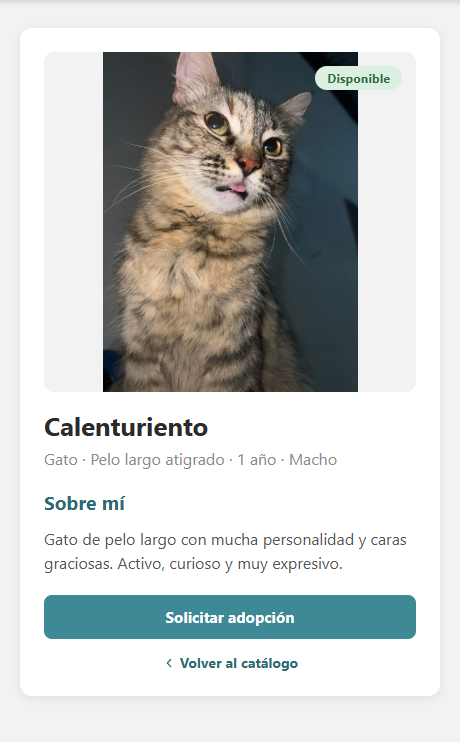
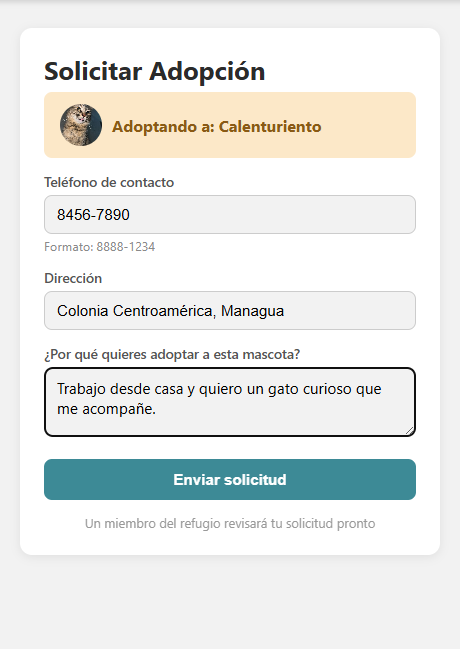

> Si la mascota está *En proceso* o *Adoptada*, el botón aparece deshabilitado.
> 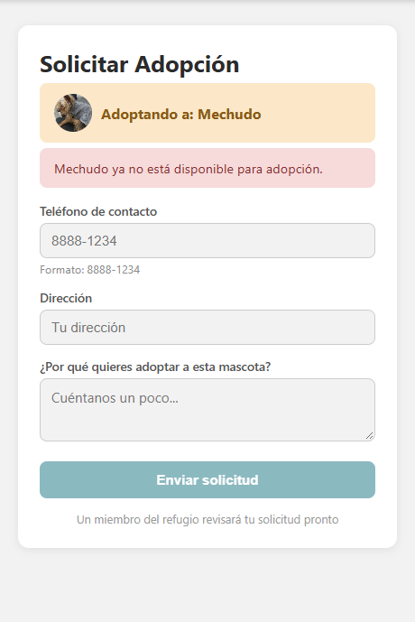

### A6. Revisar tus solicitudes
En **Mis Solicitudes** ves todas tus solicitudes con su etapa. Pulsa una para abrir su seguimiento.

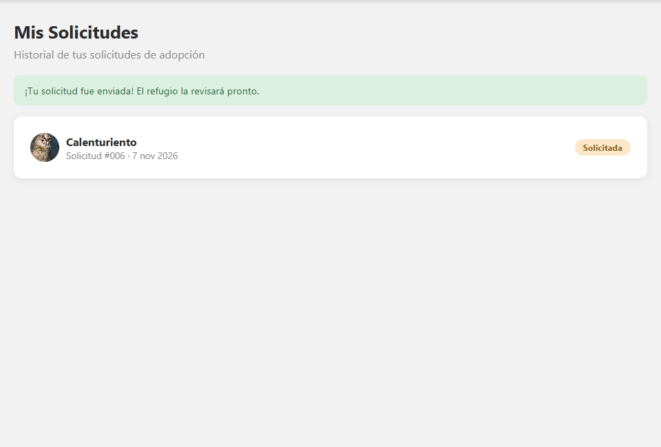

### A7. Seguir tu solicitud y ver tu entrevista
La pantalla de seguimiento muestra la **línea de tiempo** con las cinco etapas:

| Etapa | Qué significa |
|---|---|
| **Solicitada** | El refugio está revisando tu solicitud y tu perfil |
| **Entrevista programada** | El refugio agendó una entrevista presencial contigo |
| **Entrevistada** | Ya fuiste a la entrevista; falta la decisión |
| **Aprobada** | ¡La mascota es tuya! Empiezan los controles post-adopción |
| **Rechazada** (en rojo) | La solicitud no fue aprobada; puedes solicitar otra mascota |

Las etapas completadas se ven en verde con una marca, la actual resaltada en naranja y las futuras en gris. Cuando hay entrevista, la tarjeta **"Tu entrevista"** muestra el día (por ejemplo, "martes 10 de noviembre"), la hora (10:30 a. m.) y la dirección del refugio. Llega 10 minutos antes y lleva tu cédula.

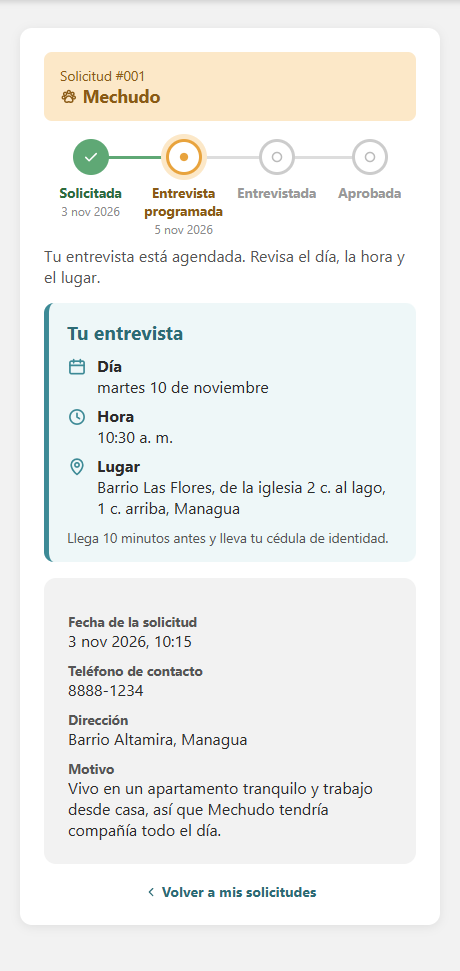

En el celular la línea de tiempo se muestra vertical:

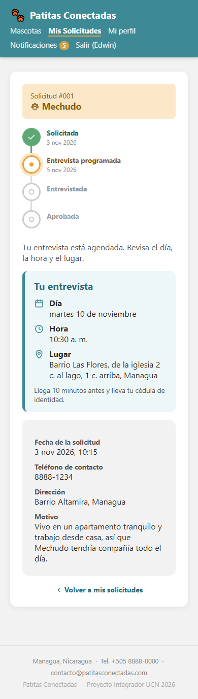

### A8. Subir la foto de un control post-adopción
Después de la adopción, el refugio programa **4 controles, uno cada 3 meses**. En la sección **"Seguimiento de tu adopción"** de tu seguimiento:

| Estado del control | Qué hacer |
|---|---|
| **Próximamente** (gris) | Nada todavía; podrás subir la foto cuando llegue la fecha |
| **Pendiente** (naranja) | Elige una foto (JPG, PNG o WEBP, máximo 2 MB), revisa la vista previa y pulsa **Subir foto** |
| **En revisión** | El refugio está revisando tu foto |
| **Todo bien** (verde) | El refugio aprobó el control; verás la miniatura y su comentario |
| **Requiere atención** (naranja) | Lee el comentario del refugio; te contactarán |

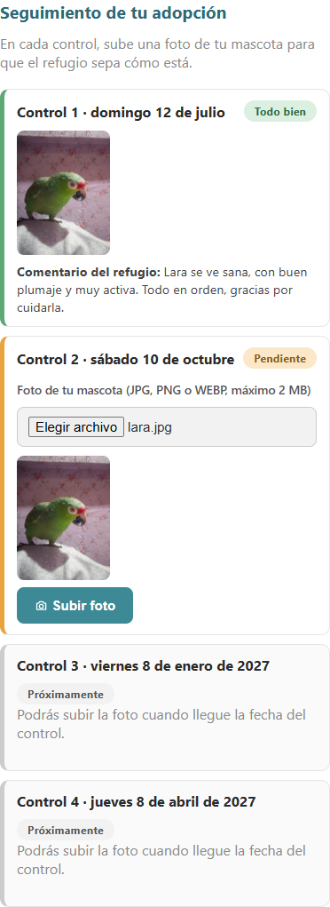

### A9. Notificaciones y recordatorios
El enlace **Notificaciones** de la barra muestra con un número cuántos avisos tienes sin leer. Recibirás un aviso cuando:
- el refugio reciba tu solicitud, agende o reprograme tu entrevista, la apruebe o la rechace;
- un control post-adopción esté **pendiente o vencido** (recordatorio);
- el refugio revise la foto de un control.

Pulsa **Ver solicitud** para ir al seguimiento, o **Marcar como leída**.

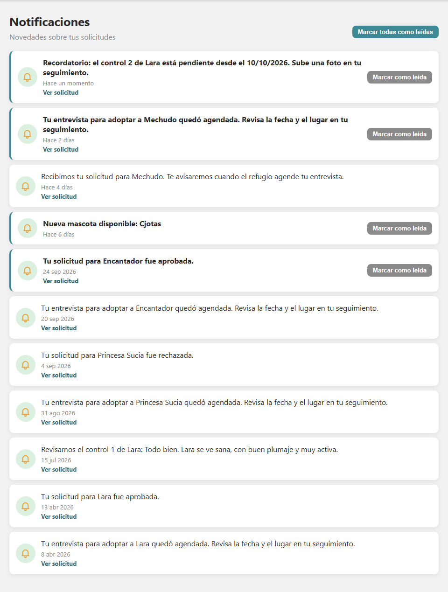

---

## Parte B — Guía del administrador

Inicia sesión con la cuenta de administrador (`admin@patitas.com`). Entrarás directamente al **Panel de Administración**.

### B1. Ver las solicitudes en curso
La tabla **Solicitudes en curso** lista las solicitudes *Solicitadas*, con *Entrevista programada* o *Entrevistadas*. Pulsa **Ver detalle** para trabajar con una.

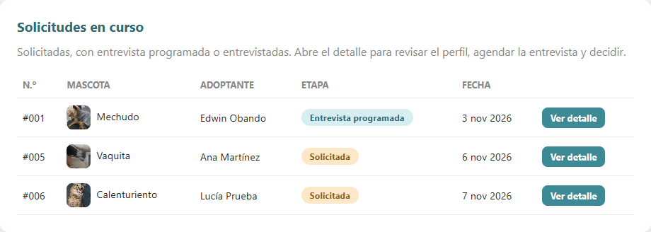

### B2. Revisar el perfil y agendar la entrevista
1. En el detalle verás los datos de la solicitud, el **perfil del adoptante** y la entrevista.
2. En **Agendar entrevista**, elige un día en el calendario. Los días pasados, los domingos y los días sin atención aparecen deshabilitados.
3. Aparecen los **horarios** del día como botones; los ocupados o pasados están tachados.
4. Elige un horario y pulsa **Agendar entrevista**. El lugar se toma de la configuración del refugio, y el adoptante recibe una notificación con el día y la hora.
5. Para **reprogramar**, elige otro día y horario en la misma pantalla y pulsa **Confirmar nueva fecha**.

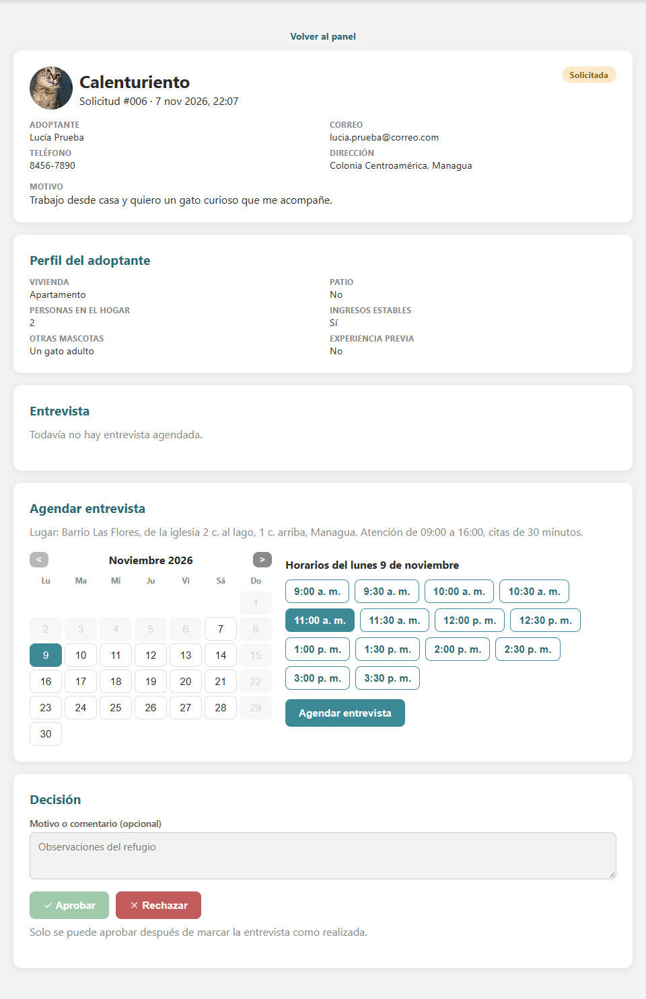
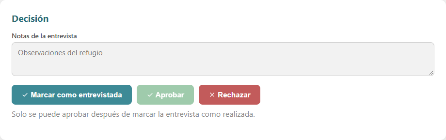

### B3. Marcar la entrevista como realizada y decidir
1. Después de la entrevista, escribe tus notas (opcional) y pulsa **Marcar como entrevistada**.
2. Solo entonces se habilita **Aprobar**. Al aprobar, la mascota pasa a *Adoptada* y se programan automáticamente los controles post-adopción.
3. **Rechazar** está disponible en cualquier etapa activa; escribe el motivo (queda en las notas internas). La mascota vuelve a *Disponible* y, si la entrevista no se había hecho, el horario queda libre.

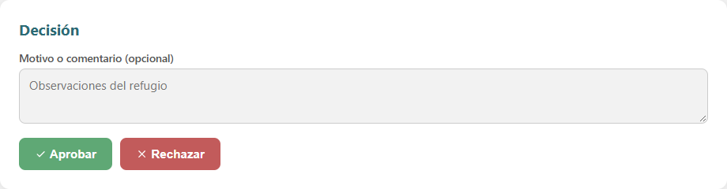
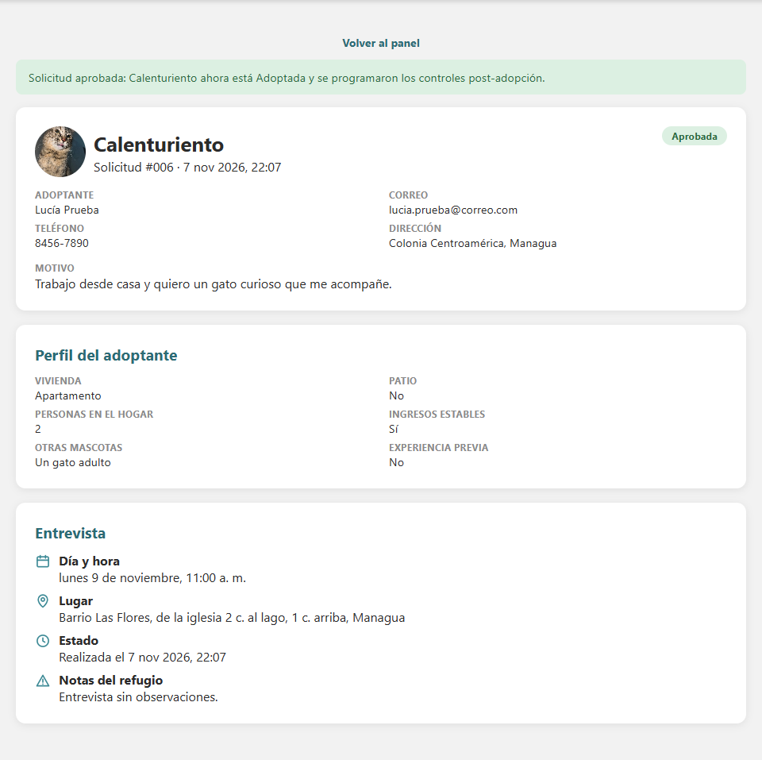

### B4. Consultar la agenda de la semana
La tarjeta **Agenda de entrevistas** muestra las citas de los próximos 7 días agrupadas por día, con la etapa y un enlace a cada solicitud.

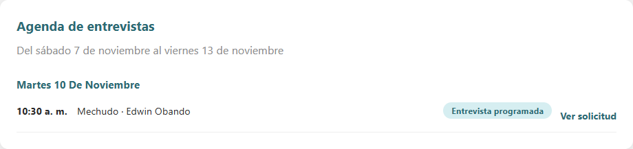

### B5. Revisar los controles post-adopción
En **Seguimientos post-adopción** aparecen los controles con la foto ya enviada. Mira la foto, escribe un comentario para el adoptante (obligatorio) y pulsa **Todo bien** o **Requiere atención**. El adoptante recibe la notificación con tu comentario.

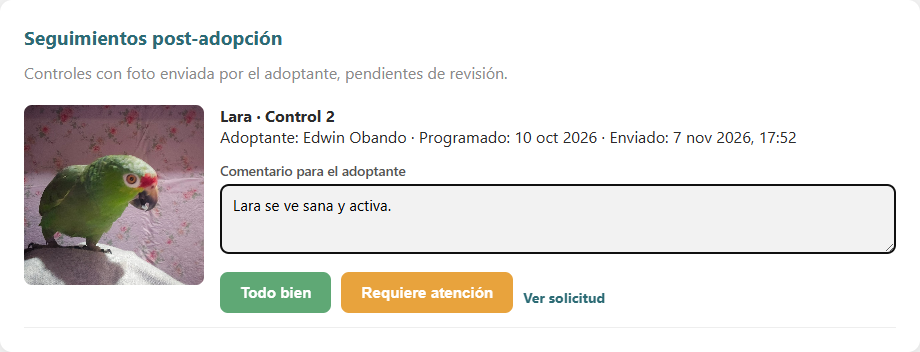

### B6. Configurar el refugio
En **Configuración del refugio** puedes cambiar el nombre, el teléfono, la **dirección** (se copia en cada entrevista nueva), el horario de apertura y cierre, la duración de cada cita y los días de atención. Los cambios se aplican a las entrevistas que se agenden después.

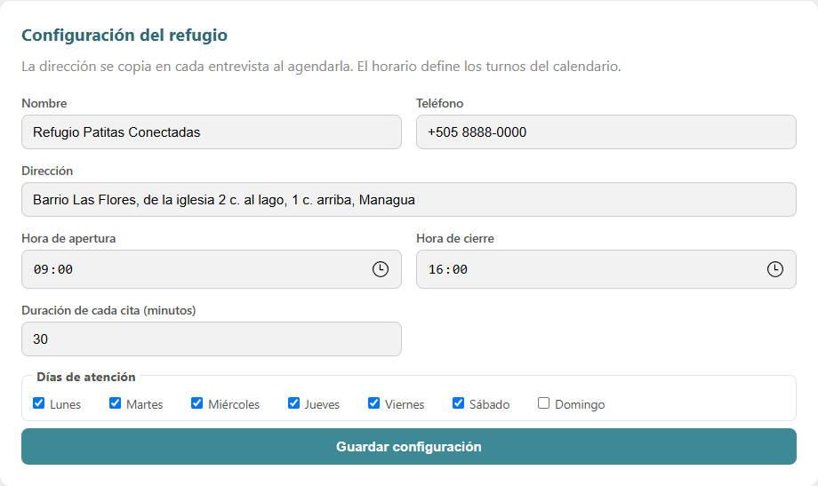

### B7. Gestionar mascotas
1. Pulsa **+ Agregar mascota**, completa los datos, elige una foto (JPG, PNG o WEBP de hasta 2 MB) y guarda.
2. Para editar, pulsa **Editar** en la fila de la mascota. El estado *En proceso* lo asigna una solicitud: no se puede elegir a mano, y una mascota con una solicitud activa o aprobada no cambia de estado desde aquí.

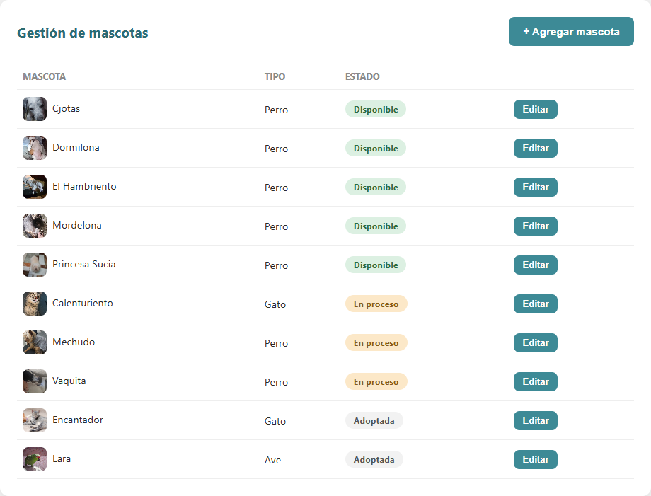
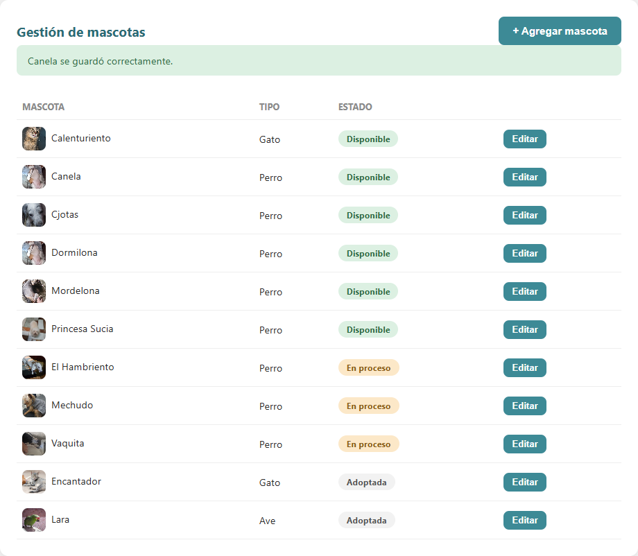

### B8. Gestionar los tipos de mascota
Agrega un tipo nuevo (por ejemplo, "Hurón") o edítalo. Un tipo no se borra: se **desactiva**, y deja de ofrecerse en los formularios y en los filtros.

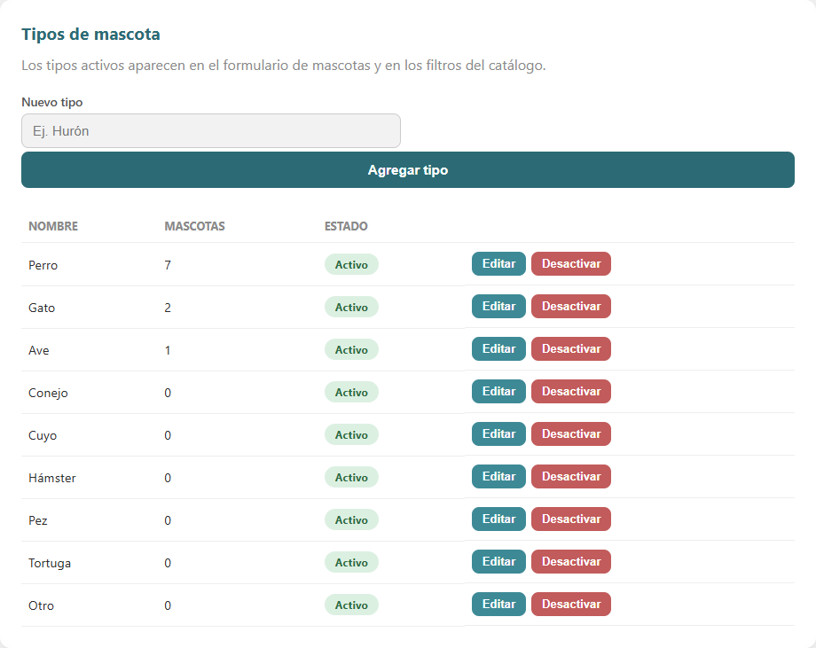

### B9. Tareas de mantenimiento (consola)
| Tarea | Comando |
|---|---|
| Generar los recordatorios de todos los adoptantes | `npm run recordatorios` |
| Aplicar migraciones pendientes a una base existente | `npm run db:migrar` (respaldar antes, doc 18) |
| Respaldar y restaurar la base | ver [`18_respaldo_recuperacion.md`](18_respaldo_recuperacion.md) |
